# 1. 요약

`-` 기존 코드에서 발전시킨 점

- MFPCA 적용: 기존에는 분해(K=3) 후 IMF 2 한 개만 사용, 지금은 모든 모드 사용. 한 개만 쓰면 (1) 데일리 이펙트를 뽑기 어렵고 (2) baseline 대비 성능 개선이 없음.
- IMF 재배치 알고리즘 적용 (§4, §5.1)
- 어퍼 엔벨롭을 먼저 구해 나누어 진폭 변조를 걷어냄 (§5.2)

# 2. Data

`-` 기본 아이디어: weekday 와 (weekend, holiday) 를 구분할 수 있는 방법을 설계함

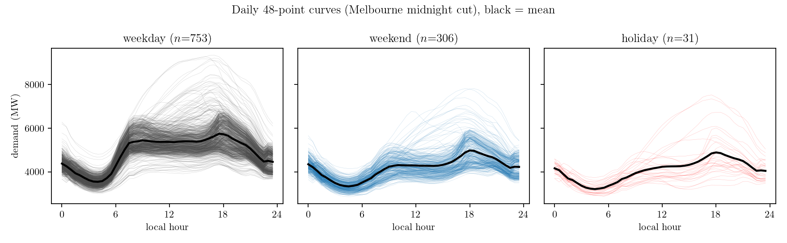

# 3. Baselines

## 3.1 Daily mean → k-means

`-` 하루 48점을 평균 하나로 줄여 k-means(k=2)를 걸어 보았음 (모양을 전혀 안 보고 수준만 보는 가장 낮은 기준).

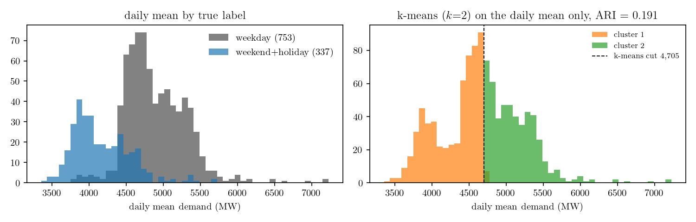

`-` ARI 가 0.191 로 매우 낮은 수준. 경계가 두 봉우리 사이 골짜기(4,208 MW)가 아니라 그 오른쪽(4,705 MW)에 서 있어서 그러함 (k-means 가 두 중심의 중점으로 자르기 때문임). 쉬는 날은 거의 다 낮은 군집에 들어가지만 평일 280일도 같이 들어감. 부트스트랩 구간 [0.06, 0.42].

`-` 라벨 정보를 알고 고르는 최적 임계점. 임계를 3,500~6,000 MW 로 훑으며 「임계 아래 = 쉬는 날」로 둘 때의 ARI 를 그린 것이 아래 왼쪽. 4,390 MW 에서 0.576 으로 최대이고, k-means 경계 4,705 MW 는 그 곡선에서 0.191 자리임. 오른쪽은 그 두 경계를 라벨별 분포 위에 그린 것.

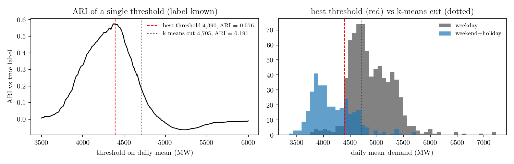

`-` 라벨을 알고 고른 최적 임계(4,390 MW)로도 0.576 이 상한.

`-` 쉬는 날의 상위 10% 가 평일의 하위 10% 보다 높아 분포가 겹치므로, 수준 하나로는 어떤 경계도 0.6 을 못 넘음.

`-` 함수의 모양으로 판단해야 함 (FPCA 를 써야 하는 이유).

`-` 성능요약: ARI 0.576 이 상한

## 3.2 B-spline → FPCA → k-means

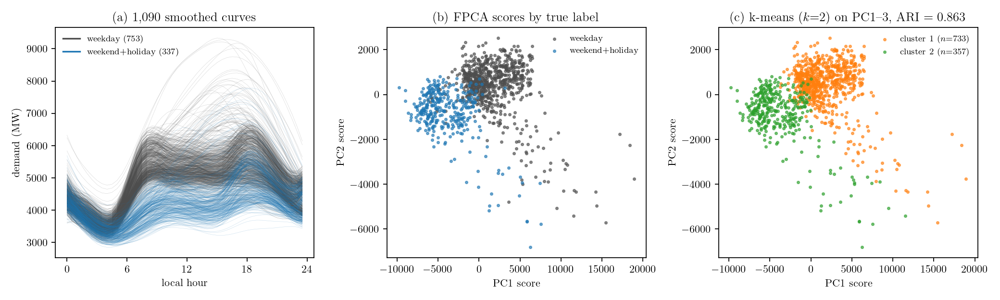

`-` 나쁘지 않음.

`-` 그런데 분해를 하고 MFPCA 를 돌리면 결과가 어떨지 궁금함.

`-` 성능요약: ARI 0.863 (평균만 사용할 경우의 성능 상한인 0.576 보다 높음)

## 3.3 Decompose → B-spline → MFPCA → k-means

`-` 결과: EMD 의 결과가 안 좋은 것에 주목

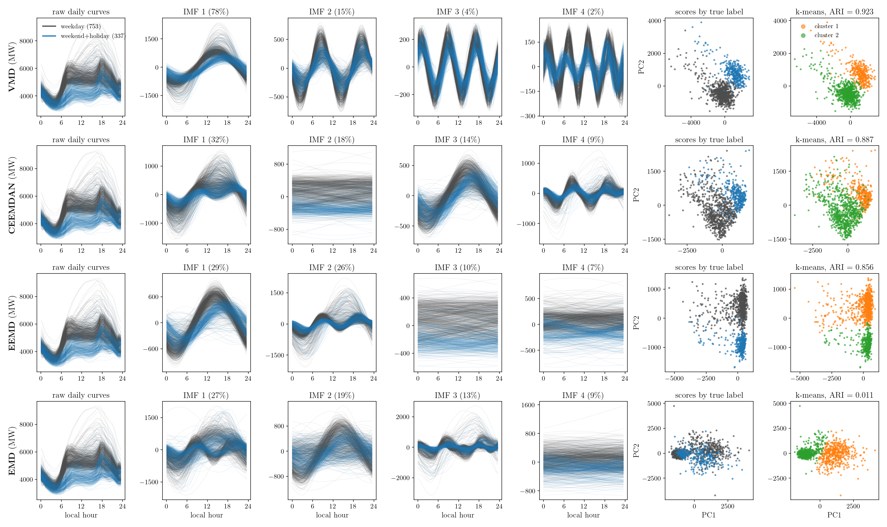

`-` 성능요약: EEMD 와 EMD 는 MFPCA 의 성능이 안 나옴.

| 절 | 설계 | ARI |
|---|---|---:|
| 3.1 | Daily mean → k-means | 0.191 |
|  | Daily mean, 라벨로 고른 최적 임계 (상한) | 0.576 |
| 3.2 | B-spline → FPCA → k-means | 0.863 |
| 3.3 | VMD → B-spline → MFPCA → k-means | 0.923 |
|  | CEEMDAN → B-spline → MFPCA → k-means | 0.887 |
|  | EEMD → B-spline → MFPCA → k-means | 0.856 |
|  | EMD → B-spline → MFPCA → k-means | **0.011** |

`-` 까닭: EMD 는 날마다 daily wave 가 다른 IMF 에 할당됨(모드 혼합). 다른 방법도 이러한 현상이 생길 수 있지만 유독 EMD 가 심함 $\Rightarrow$ 4장의 모티브

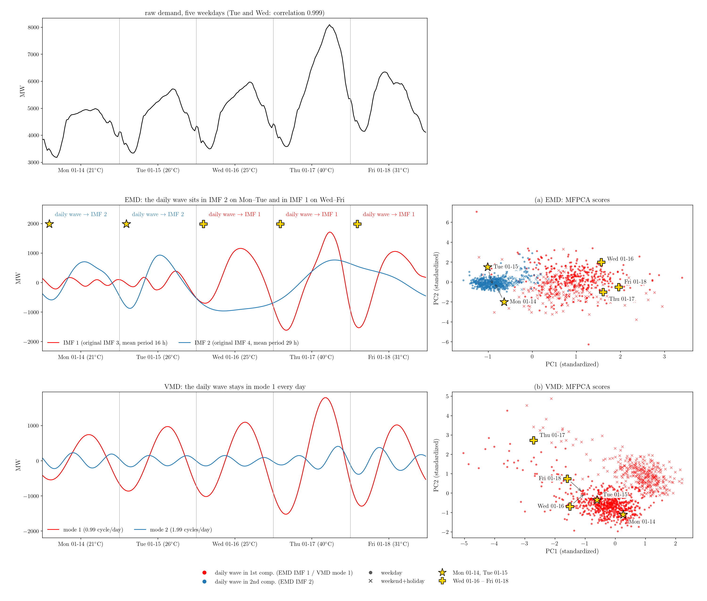

`-` Note: VMD 는 FFT 기반이므로 tone 이 섞이지 않음 (따라서 VMD 와 MFPCA 의 궁합이 좋음).

# 4. IMF 재배치 알고리즘

`-` 모드 혼합을 줄이기 위한 방법: (1) 원신호의 지배주파수 몇 개를 찾아 주파수 칸을 미리 정해 둔다. (2) 날마다 각 IMF 의 지배주파수를 재어 해당 칸에 재배치하고, 같은 칸에 든 IMF 는 더한다.

(1) 원신호의 지배주파수 찾기

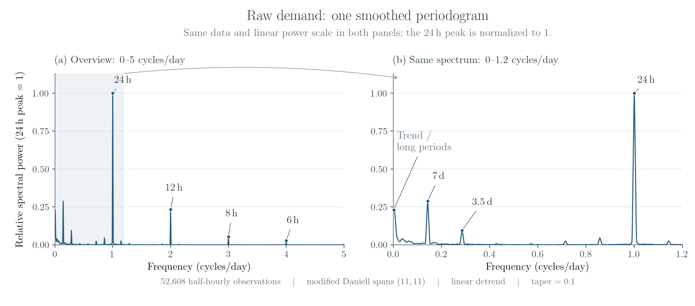

| 보정 후 IMF | 미리 정한 지배주파수 | 주기 |
|---:|---|---|
| 1 | 1 cycle/day | 24시간 |
| 2 | 2 cycles/day | 12시간 |
| 3 | 3 cycles/day | 8시간 |
| 4 | 4 cycles/day 이상 | 6시간 이하 |

(2) 재배치 과정

`-` 재배치 과정 예시 1 (하루)

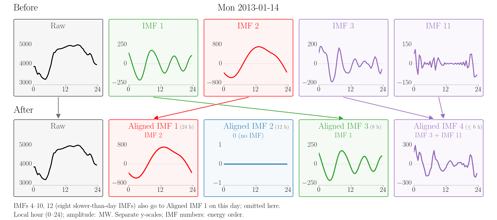

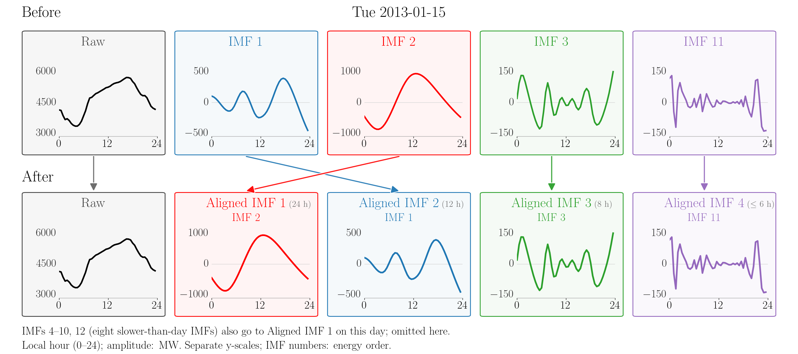

`-` 재배치 과정 예시 2 (일주일)

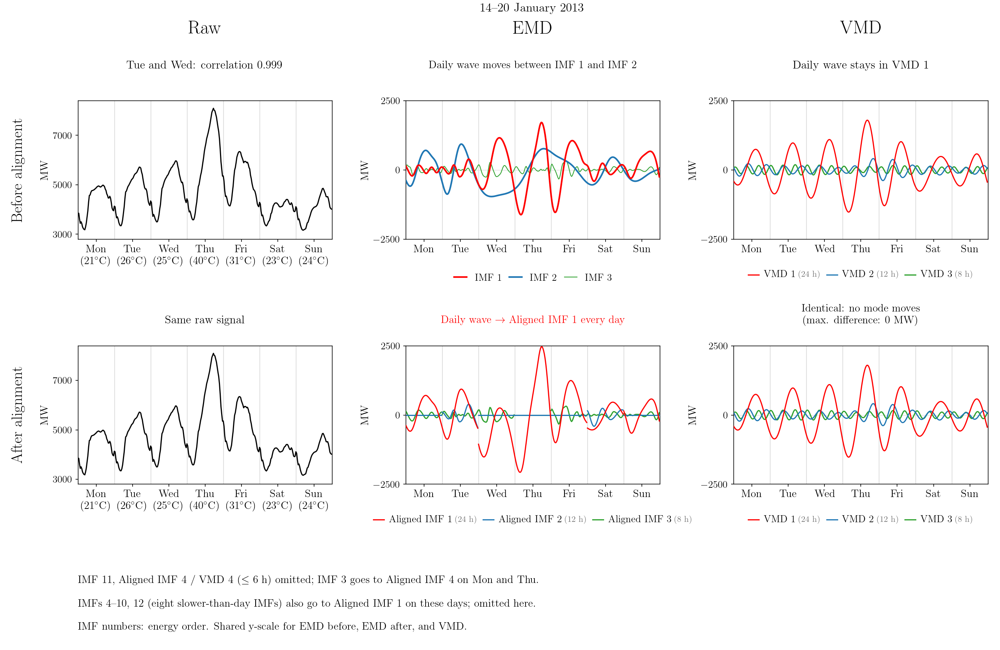

`-` 자정의 점프 (예시 2 의 화·수 이틀을 확대)

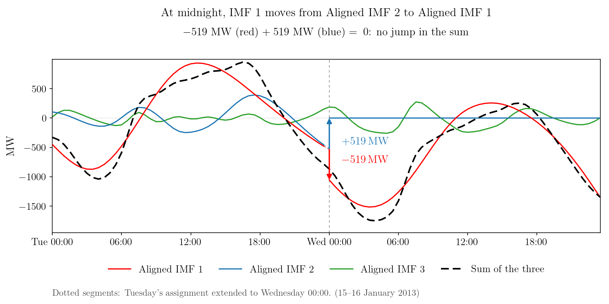

- IMF 1(빨강)의 $-$ jump 와 IMF 2(파랑)의 $+$ jump 가 서로 상쇄됨
- IMF 를 보정하면서 생기는 어쩔 수 없는 현상.

# 5. Proposed

## 5.1 제안하는 방법 1: 분해 → 보정 → B스플라인 → MFPCA → k-means

`-` 절차

(1) 분해: EMD·EEMD·CEEMDAN 은 기본값대로 끝까지, VMD 는 K=8. 잔차를 버리고 분산 누적 99% 까지의 IMF 사용.

(2) 보정: §4 의 방법으로 날마다 IMF 를 1 · 2 · 3 · 4+ cycles/day 칸에 재배치(같은 칸은 더함). 한 날 = 함수 넷.

(3) B스플라인: 하루 48점을 nbasis 12 로 평활.

(4) MFPCA: 가중 = 칸별 에너지 비율, M=3.

(5) k-means: 점수를 표준화해 k=2.

`-` 결과

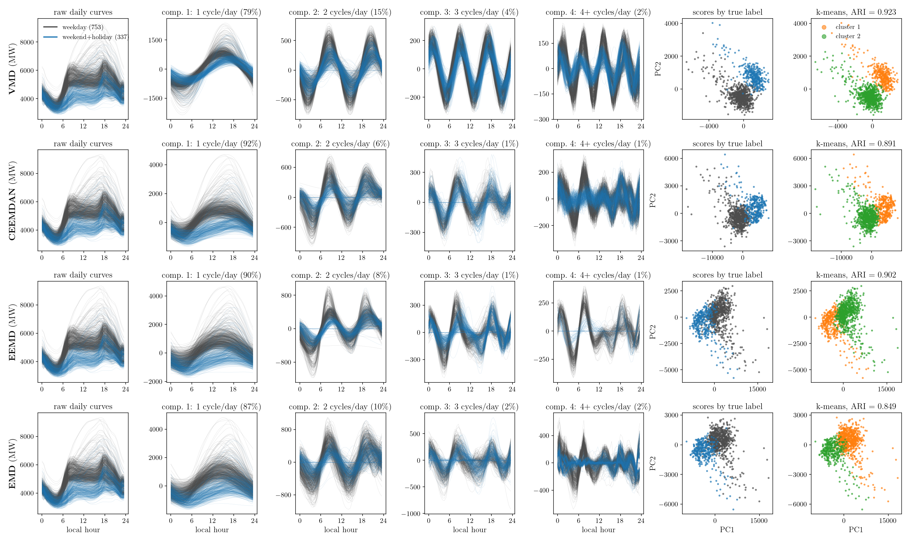

`-` 성능요약: CEEMDAN·EEMD·EMD 셋 다 보정 전보다 높아 보정의 효과가 있음 (EMD 는 0.011 → 0.849 로 매우 뚜렷함). 다만 분해의 효과를 보이는 기준선(0.863)보다는 VMD·CEEMDAN·EEMD 셋만 높고 EMD 는 0.849 로 조금 못 미침. VMD 는 보정의 효과가 없음 (0.923 그대로). 결론적으로는 VMD 가 0.923 으로 가장 높음.

| 절 | 설계 | ARI |
|---|---|---:|
| 3.1 | Daily mean → k-means | 0.191 |
|  | Daily mean, 라벨로 고른 최적 임계 (상한) | 0.576 |
| 3.2 | B-spline → FPCA → k-means | 0.863 |
| 3.3 | VMD → B-spline → MFPCA → k-means | 0.923 |
|  | CEEMDAN → B-spline → MFPCA → k-means | 0.887 |
|  | EEMD → B-spline → MFPCA → k-means | 0.856 |
|  | EMD → B-spline → MFPCA → k-means | **0.011** |
| 5.1 | VMD → 보정 → B-spline → MFPCA → k-means | 0.923 |
|  | CEEMDAN → 보정 → B-spline → MFPCA → k-means | 0.891 |
|  | EEMD → 보정 → B-spline → MFPCA → k-means | 0.902 |
|  | EMD → 보정 → B-spline → MFPCA → k-means | 0.849 |

## 5.2 제안하는 방법 2: EBT 어퍼 엔벨롭 제거 → EBT 주기성분 추출 → 하루 단위로 자름 → B스플라인 → MFPCA → k-means

`-` 절차 (모형 $f(t) = A(t) \times [p(t)+q(t)]$, Choi & Oh 2024)

(1) EBT 어퍼 엔벨롭 제거: 어퍼 엔벨롭 $A=u^{f,48}$ ($\tau$ = 48, 하루)로 진폭을 복조해 $r=f/A$.

(2) 주기성분 추출: $r$ 에서 $\tau=48$ 로 $p^{(k+1)}=p^{(k)}-m^{p^{(k)},48}$ 을 수렴까지 반복해 주기 48 성분 $p_{48}$, 나머지 $q=r-p_{48}$.

(3) B스플라인: $p_{48}, q, A$ 를 하루 48점으로 잘라 평활. 한 날 = 함수 셋.

(4) MFPCA: 분산 정규화 가중, M=3.

(5) k-means: k=2.

`-` EBT를 이용하여 어퍼 엔벨롭을 제거한 뒤 분해하는 예시

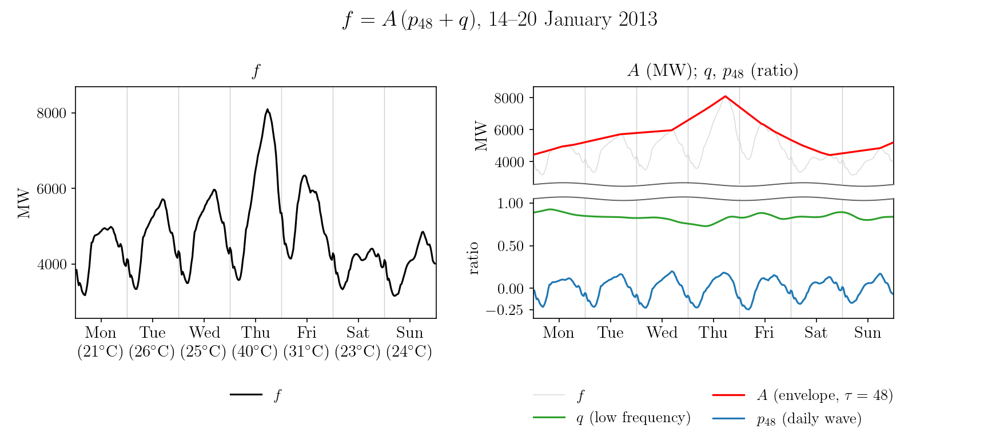

`-` 결과

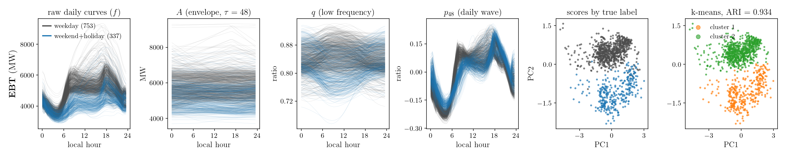

`-` 성능요약: $(p_{48}, q, A)$ 셋을 함께 쓴 것이 0.934 로 지금까지 가장 높음.

| 절   | 설계                                                      | ARI                  |
| --- | ------------------------------------------------------- | -------------------: |
| 3.1 | Daily mean → k-means                                    | 0.191                |
|     | Daily mean, 라벨로 고른 최적 임계 (상한)                           | 0.576                |
| 3.2 | B-spline → FPCA → k-means                               | 0.863                |
| 3.3 | VMD → B-spline → MFPCA → k-means                        | 0.923                |
|     | CEEMDAN → B-spline → MFPCA → k-means                    | 0.887                |
|     | EEMD → B-spline → MFPCA → k-means                       | 0.856                |
|     | EMD → B-spline → MFPCA → k-means                        | 0.011                |
| 5.1 | VMD → 보정 → B-spline → MFPCA → k-means                   | 0.923                |
|     | CEEMDAN → 보정 → B-spline → MFPCA → k-means               | 0.891                |
|     | EEMD → 보정 → B-spline → MFPCA → k-means                  | 0.902                |
|     | EMD → 보정 → B-spline → MFPCA → k-means                   | 0.849                |
| 5.2 | EBT → $(p_{48}, q, A)$ → B-spline → MFPCA → k-means | 0.934 |

# 6. Discussion

`-` 고민 1: 4절에 소개한 IMF 재배치 알고리즘에 뭔가 포인트를 주고 싶었는데 (이론 정리 등) 결과가 좋지 않아서 고민 중임.

- 결과적으로 VMD가 5.1의 방법들 중 최고 성능이라 4절의 내용이 무색해짐
- EMD, EEMD, CEEMDAN을 보정하는 효과는 있긴 해서… 아예 쓸모없진 않고 살리고 싶긴 한데, 살리는 방법이 애매함

`-` 고민 2: 고민 1 때문에 VMD를 이길 방법을 찾다가 예전에 내가 만든 EBT를 적용해 봄. 결과는 VMD보다 조금 더 좋음. 이걸 메인 논리로 가면

- 컨트리뷰션 1: 엔벨롭을 미리 구해서 나누고 시작한다는 참신함(?)
- 컨트리뷰션 2: EBT는 주기 함수의 형태가 sinusoid 라는 제약이 없어 데일리 웨이브가 깔끔하게 뽑힘. 이게 분류에 도움이 됨.

이런 식으로 정리됨. 이렇게 갈 경우 단점은 MFPCA가 메인이 느낌이 아니라 이러면 EBT의 후속 논문 느낌이 된다는 것. 

`-` 고민 3: 계절에 따른 모양도 좀 다른데, 이걸로 label을 확장할까 고민 중. 이건 주 고민은 아니고 약간 마이너한 고민임. (사실 계절별로 잠깐 돌려 보긴 했는데 결과가 그닥임. 차라리 여름 vs other 로 나누면 논문의 경쟁력이 좀 더 올라갈 듯한데 이건 아직 시도 안 해 봄)

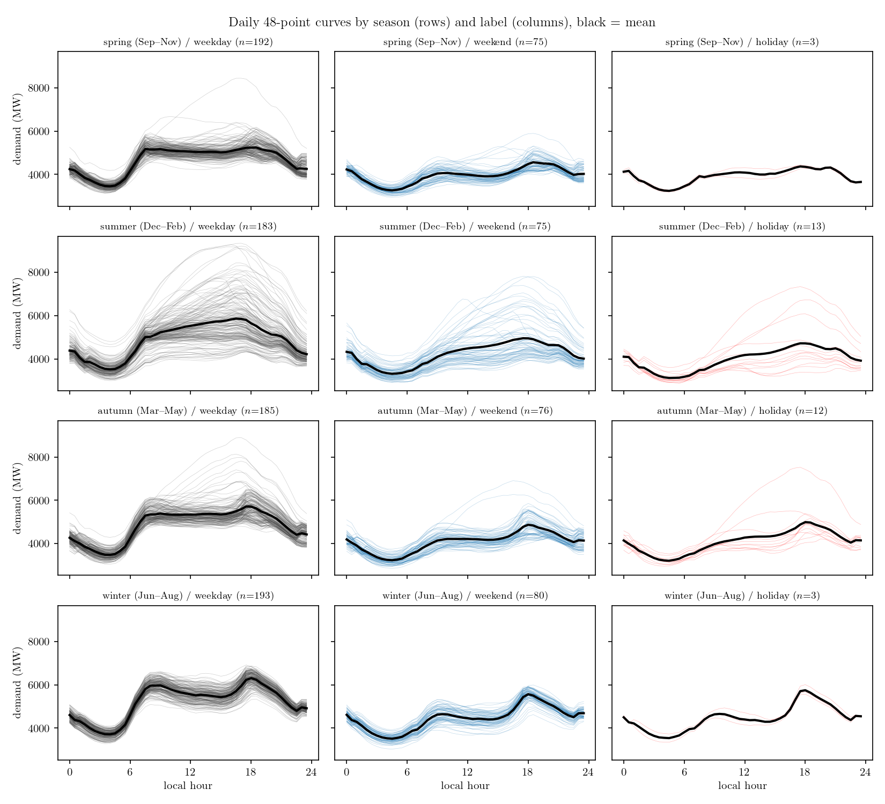

`-` 고민 4: 아예 다른 데이터로 시작할까도 고민 중. EBT의 후속 논문 쪽으로 준비한다면 태양광 같은 것을 더해 데이터 2개를 준비하면 될 듯.

`-` 종합

- IMF 재배치를 살리는 쪽으로 갈지: 여기는 뭐 좀 쓸 게 있을 것 같음. 쓰기도 쉬워 보임. 이것저것 이론 전개를 해 보는 중임.
- EBT의 후속으로 갈지: 결과가 좋긴 한데, 이 결과가 왜 좋은지를 이론적으로 설명할 수 있을지 모르겠음 (시도 안 해 봄)
