지난 리포트 §5.1 그림 꼴을 실자료에 그림 — 줄마다 한 분해 방법 (VMD · CEEMDAN · EEMD · EMD), 칸은 왼쪽부터 원곡선 · 보정 성분 넷 (1 · 2 · 3 · 4+ cycles/day, 괄호는 칸 에너지 비율) · MFPCA 점수 (참 라벨) · k-means (k = 2) 군집과 ARI. 자료마다 사건 · 대조가 가장 고른 지점 하나 (둘 중 적은 쪽의 날 수가 가장 많은 곳). 라벨은 박민수 교수 문서대로. 모든 지점의 ARI 는 [FDecomp 실자료 5 — 지점별 성능 대시보드](261015_연구_FDecomp_지점별성능대시보드.qmd).

`-` 색 — 회색 = 대조 · 파랑 = 사건 (맨 윗줄 범례는 자료 파일의 라벨 이름), 군집은 주황 · 초록.

## 에어코리아 — 수지 (경기도)

`-` PM2.5 · 사건 «주의보» 77일 / 대조 «청정 · 강수» 812일 · ARI — 3.1 상한 0.808 · 3.2 FPCA 0.719 · 5.1 VMD 0.626 · 5.1 CEEMDAN 0.726 · 5.1 EEMD 0.701 · 5.1 EMD 0.742

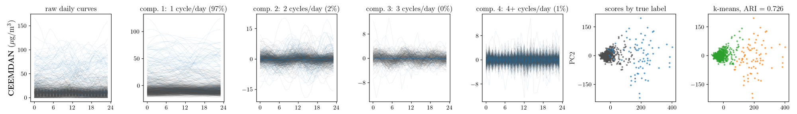

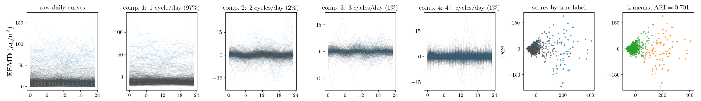

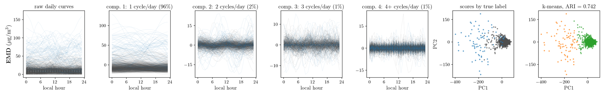

## EPA AQS — Redlands (California / Riverside-San Bernardino-Ontario, CA)

`-` O3 · 사건 «AQI USG 이상» 579일 / 대조 «Good · Moderate» 1136일 · ARI — 3.1 상한 0.582 · 3.2 FPCA 0.655 · 5.1 VMD 0.611 · 5.1 CEEMDAN 0.665 · 5.1 EEMD 0.657 · 5.1 EMD 0.692

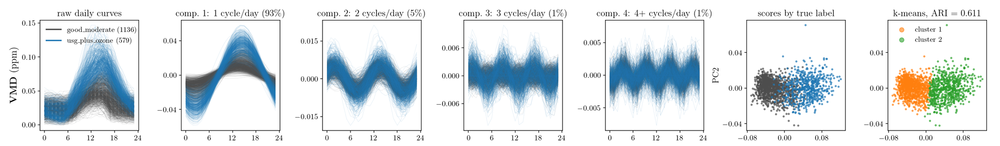

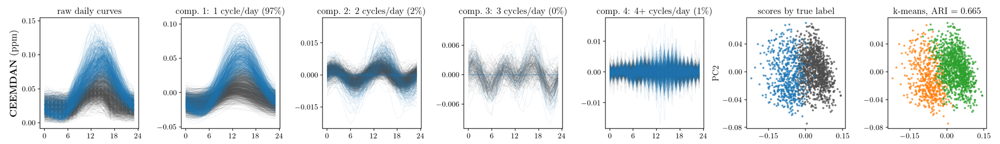

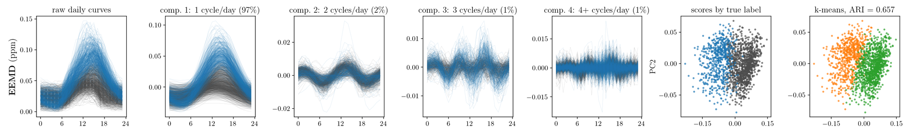

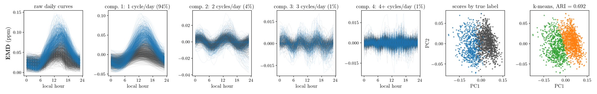

## OpenAQ — Los Angeles – N. Main (California / Los Angeles-Long Beach-Anaheim, CA)

`-` PM2.5 · 사건 «AQI USG 이상» 24일 / 대조 «Good · Moderate» 436일 · ARI — 3.1 상한 0.903 · 3.2 FPCA 0.203 · 5.1 VMD 0.203 · 5.1 CEEMDAN 0.203 · 5.1 EEMD 0.203 · 5.1 EMD 0.203

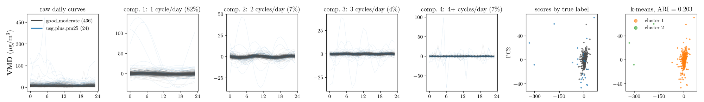

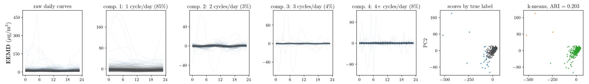

## WEIS — 칠서 (경상남도 · 낙동강 수계)

`-` DO · 사건 «조류경보» 417일 / 대조 «평상시» 581일 · ARI — 3.1 상한 0.060 · 3.2 FPCA 0.045 · 5.1 VMD 0.061 · 5.1 CEEMDAN 0.070 · 5.1 EEMD 0.051 · 5.1 EMD 0.043

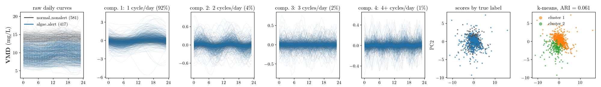

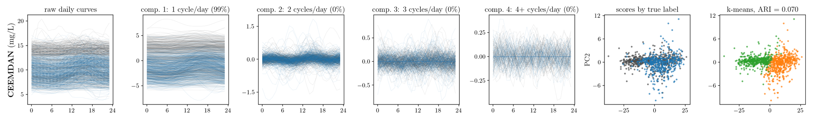

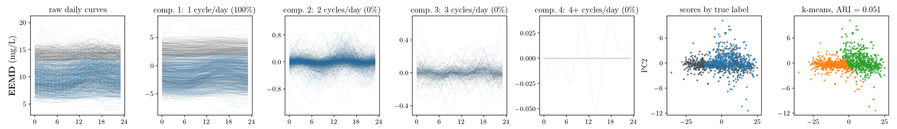

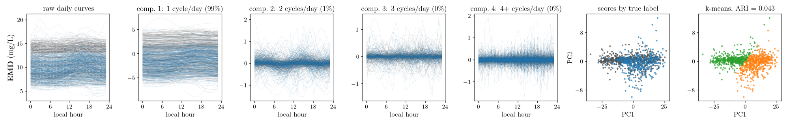

## USGS — SOUTH RIVER AT FORREST PARK ROAD, AT ATLANTA, GA (Georgia (GA) · Atlanta-Sandy Springs-Roswell, GA 대도시권)

`-` DO · 사건 «강우 유출 · 홍수 유입» 368일 / 대조 «기저 유출 평수기» 384일 · ARI — 3.1 상한 0.103 · 3.2 FPCA 0.077 · 5.1 VMD 0.203 · 5.1 CEEMDAN 0.064 · 5.1 EEMD 0.081 · 5.1 EMD 0.031

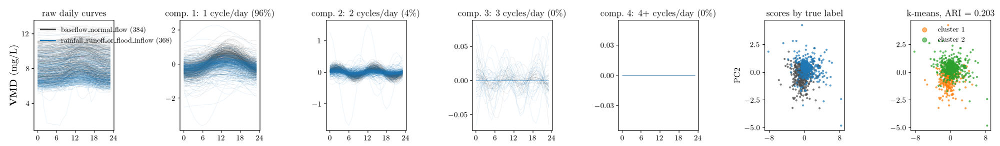

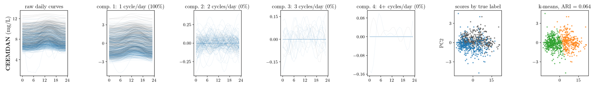

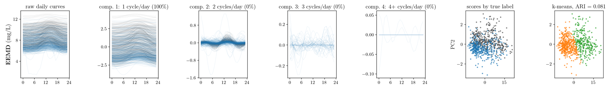

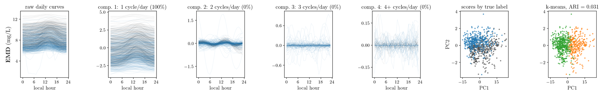

## 기상청 ASOS ① — 대구 (대구광역시)

`-` 기온 · 사건 «폭염 · 열대야» 226일 / 대조 «비폭염» 1598일 · ARI — 3.1 상한 0.801 · 3.2 FPCA 0.082 · 5.1 VMD -0.004 · 5.1 CEEMDAN 0.083 · 5.1 EEMD 0.074 · 5.1 EMD 0.075

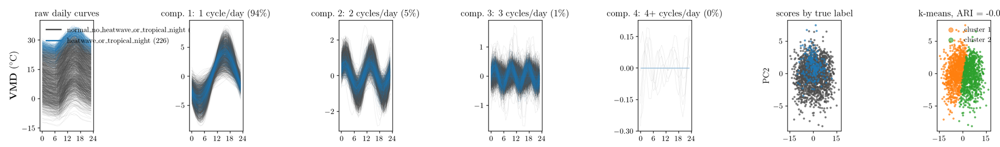

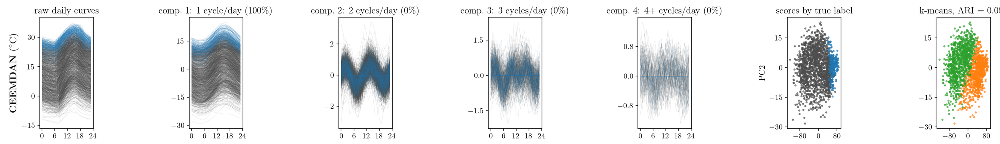

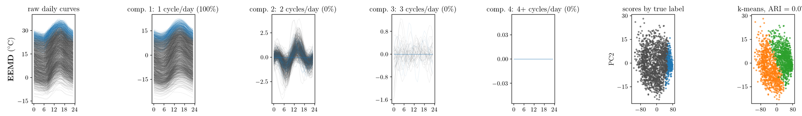

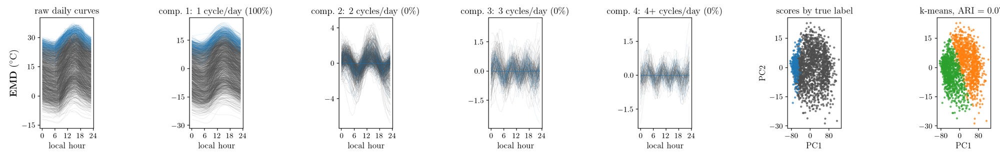

## 기상청 ASOS ② — 광주 (전남광주통합특별시)

`-` 기온 · 사건 «강우 · 흐림» 699일 / 대조 «맑음» 688일 · ARI — 3.1 상한 0.032 · 3.2 FPCA 0.125 · 5.1 VMD 0.492 · 5.1 CEEMDAN 0.167 · 5.1 EEMD 0.143 · 5.1 EMD 0.113

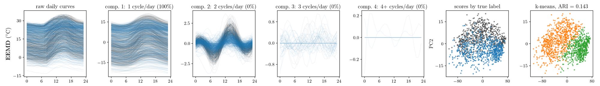

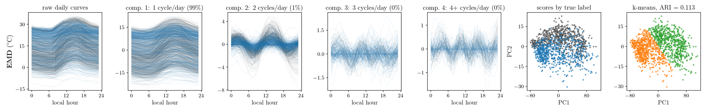

## NOAA ISD — Portland International (OR / Portland-Vancouver-Hillsboro, OR-WA)

`-` 기온 · 사건 «한랭 전선 · 강수» 548일 / 대조 «고온 건조» 373일 · ARI — 3.1 상한 0.874 · 3.2 FPCA 0.927 · 5.1 VMD 0.911 · 5.1 CEEMDAN 0.923 · 5.1 EEMD 0.911 · 5.1 EMD 0.919

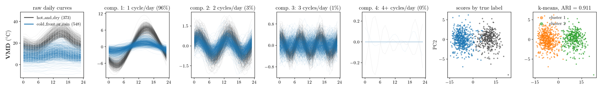

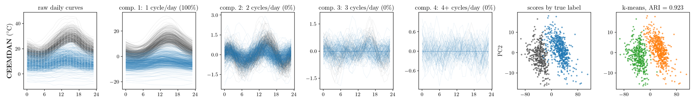

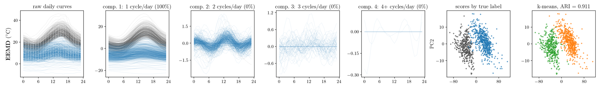

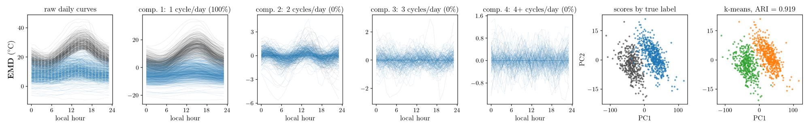

`-` 그림 `261014_아리아_실자료4x7그림.py --tag 교수님라벨_전지점` (아리아) · 자르기 `ms_strips_post.py`.
