제안 문서 (`Real_Data_DecompFPCA.docx`) 의 자료 여덟 가지에 리포트 1 (vic_elec) 의 절차를 그대로 돌림. 지점은 문서 범위 안의 것을 전부 받았고, 라벨은 문서의 군집화 라벨대로 날마다 하나씩 만듦. 값은 ARI (k-means, k = 2). 설계 — 일평균 최적 문턱 (오라클 — 일평균에 라벨을 보고 고른 가장 좋은 문턱을 그어 가른 결과 · 방법이 아니라 비교 기준) · FPCA (하루 곡선 → B-스플라인 → FPCA) · VMD+MFPCA 등 (분해 → 성분마다 이틀보다 느린 변동을 걷어냄 → 보정 → B-스플라인 → MFPCA, 그 점수에 하루 평균을 더해 k-means — 네 분해 모두 같은 규칙).

# 1. 원자료 보기

자료 · 지점 · 기간을 고르면 그 기간의 시간 단위 원자료를 그림. 바탕색은 그날의 라벨 (사건 · 대조, 빈칸은 라벨 없음) — 라벨은 날마다 하나라 하루 (현지 표준시 0 – 24시) 가 한 색. 라벨은 그린 값이 아니라 문서의 기준 (주의보 · AQI · 조류경보 · 유량 · 날씨) 으로 정함 — 예를 들어 에어코리아 사건은 «그 권역에 주의보 · 경보가 걸친 날» 이라 밤에 내려 이튿날 아침에 풀린 주의보는 이틀이 다 사건. 실은 지점 — 작은 자료 (ASOS · OpenAQ · WEIS · ISD) 는 계산한 지점 전부, 큰 자료 (에어코리아 · EPA · USGS) 는 시도 · 주마다 사건 · 대조가 가장 고른 지점부터 30곳 (모두 172곳).

```{ojs}
rIdx = FileAttachment("attachments/261015_ca1073_raw/index.csv").csv({typed: true})
info = FileAttachment("attachments/261015_ca1073_03.json").json()
RC = ({사건: "#eb6834", 대조: "#2a78d6", 없음: "#b5b3ab", ink: "#0b0b0b", surface: "#fcfcf7"})
RUNIT = ({에어코리아: "PM2.5 (µg/m³)", OpenAQ: "PM2.5 (µg/m³)", WEIS: "DO (mg/L)", USGS: "DO (mg/L)", "기상청 ASOS ①": "기온 (°C)", "기상청 ASOS ②": "기온 (°C)", "NOAA ISD": "기온 (°C)"})
rUnit = d => d.자료 === "EPA AQS" ? (d.series.endsWith("_o3") ? "O3 (ppm)" : "PM2.5 (µg/m³)") : RUNIT[d.자료]
ymd = d => `${d.getUTCFullYear()}-${String(d.getUTCMonth() + 1).padStart(2, "0")}-${String(d.getUTCDate()).padStart(2, "0")}`
dayIndex = (s, d0) => Math.round((Date.parse(s + "T00:00:00Z") - Date.parse(d0 + "T00:00:00Z")) / 864e5)
RLAB = ({"1": "사건", "0": "대조", ".": "없음"})
fd = x => x instanceof Date ? ymd(x) : String(x)
```

```{ojs}
//| layout-ncol: 2
viewof rSrc = Inputs.select([...new Set(rIdx.map(d => d.자료))], {label: "자료", value: "에어코리아", width: 150})
viewof rSt = Inputs.select(rIdx.filter(d => d.자료 === rSrc), {label: "지점", format: d => `${d.지점} · ${d.지역}`, width: 180})
viewof rT0 = Inputs.date({label: "시작", value: "2021-01-26", width: 150})
viewof rT1 = Inputs.date({label: "끝", value: "2021-02-15", width: 150})
```

```{ojs}
rRaw = d3.json(`attachments/261015_ca1073_raw/${rSt.file}`)
rWin = {
  const a = Math.max(0, dayIndex(ymd(rT0), rRaw.d0)), b = Math.min(rRaw.n - 1, dayIndex(ymd(rT1), rRaw.d0))
  const t00 = Date.parse(rRaw.d0 + "T00:00:00Z"), K = rRaw.P, days = [], pts = []
  for (let i = a; i <= b; i++) {
    const lab = RLAB[rRaw.lab[i]], vals = rRaw.v.slice(i * K, (i + 1) * K)
    days.push({i, t0: new Date(t00 + i * 864e5), t1: new Date(t00 + (i + 1) * 864e5), lab, vals})
    vals.forEach((v, h) => pts.push({t: new Date(t00 + i * 864e5 + h * 864e5 / K), v, h: h * 24 / K, day: i, lab}))
  }
  return {a, b, days, pts, ok: b >= a}
}
rLab = info.find(d => d.자료 === rSt.자료)
md`**${rSt.지점}** · ${rSt.지역} · ${rSt.자료} · ${rUnit(rSt)} — 자료 ${fd(rSt.d0)} ~ ${fd(rSt.d1)} · 쓴 날 사건 ${rSt.n1} · 대조 ${rSt.n0}
${rWin.ok ? `· 고른 기간 ${rWin.days.length}일 (사건 ${rWin.days.filter(d => d.lab === "사건").length} · 대조 ${rWin.days.filter(d => d.lab === "대조").length} · 빈 시각 ${rWin.pts.filter(d => d.v == null).length})` : "· **고른 기간이 이 지점의 자료 밖입니다**"}

사건 vs 대조 — ${rLab ? rLab.라벨 : ""}. ${rLab ? rLab.규칙 : ""}`
```

```{ojs}
rWin.ok ? Plot.plot({
  width: Math.min(width, 1100), height: 300, marginLeft: 52, style: {background: RC.surface},
  x: {type: "utc", label: null}, y: {label: rUnit(rSt), grid: true},
  color: {domain: ["사건", "대조"], range: [RC.사건, RC.대조], legend: true},
  marks: [
    Plot.rectX(rWin.days.filter(d => d.lab !== "없음"), {x1: "t0", x2: "t1", fill: "lab", fillOpacity: 0.16}),
    Plot.lineY(rWin.pts, {x: "t", y: "v", stroke: RC.ink, strokeWidth: 1.2, tip: {format: {x: d => d.toISOString().slice(0, 16).replace("T", " "), y: true}}})
  ]
}) : html`<p>시작과 끝을 ${fd(rSt.d0)} ~ ${fd(rSt.d1)} 안에서 고르십시오.</p>`
```

```{ojs}
rCurves = rWin.ok ? rWin.days.filter(d => d.vals.some(v => v != null)).flatMap(d => d.vals.map((v, h) => ({h: h * 24 / rRaw.P, v, day: d.i, lab: d.lab}))) : []
rMeans = ["사건", "대조"].flatMap(l => {
  const ds = rWin.ok ? rWin.days.filter(d => d.lab === l) : []
  if (!ds.length) return []
  return d3.range(rRaw.P).map(h => ({h: h * 24 / rRaw.P, v: d3.mean(ds, d => d.vals[h]), lab: l}))
})
rWin.ok ? Plot.plot({
  width: Math.min(width, 700), height: 320, marginLeft: 52, style: {background: RC.surface},
  x: {label: "시각 (현지 표준시)", domain: [0, 24], ticks: [0, 6, 12, 18, 24]}, y: {label: rUnit(rSt), grid: true},
  color: {domain: ["사건", "대조", "없음"], range: [RC.사건, RC.대조, RC.없음], legend: true},
  marks: [
    Plot.lineY(rCurves, {x: "h", y: "v", z: "day", stroke: "lab", strokeWidth: 0.8, strokeOpacity: 0.45}),
    Plot.lineY(rMeans, {x: "h", y: "v", z: "lab", stroke: "lab", strokeWidth: 3}),
  ]
}) : html``
```

고른 기간의 하루 곡선 — 가는 선은 하루, 굵은 선은 라벨마다의 평균.

```{ojs}
rEvs = d3.range(rRaw.n).filter(i => rRaw.lab[i] === "1").map(i => ymd(new Date(Date.parse(rRaw.d0 + "T00:00:00Z") + i * 864e5)))
md`이 지점의 사건 날 ${rEvs.length}일 — ${rEvs.slice(0, 40).join(" · ")}${rEvs.length > 40 ? " …" : ""}`
```

# 2. 성능 요약

## 자료와 라벨

| 자료         | 문서의 라벨                                     | 판정 규칙                                                                                                                               |
| ---------- | ------------------------------------------ | ----------------------------------------------------------------------------------------------------------------------------------- |
| 에어코리아      | 대기 정체 · 고농도 미세먼지 주의보 발령일 vs 청정 대기 확산 · 강수일 | 1 = 지점이 속한 권역에 PM2.5 주의보 · 경보가 걸친 날 / 0 = 그 밖의 날 중 그 권역의 PM2.5 예보 (당일 최종 발표) 가 «좋음» 이거나 가장 가까운 ASOS 일강수 ≥ 1 mm 인 날                  |
| EPA AQS    | AQI USG 이상 vs Good · Moderate              | 1 = 카운티 일 AQI ≥ 101 이고 그날 AQI 를 정한 물질이 이 지점의 물질인 날 / 0 = 카운티 일 AQI 가 Good · Moderate 인 날                                            |
| OpenAQ     | (라벨 없음)                                    | LA: EPA 규칙 (LA 카운티 · PM2.5) / 서울 종로구: 에어코리아 규칙                                                                                      |
| WEIS       | 조류경보제 발령 기간 vs 평상시 정상일                     | 1 = 대응하는 조류경보 지점에 경보 (관심 이상) 가 걸린 날 / 0 = 경보가 아님이 확인된 날 (모든 달). 대응하는 경보 지점이 없는 곳은 라벨 없음                                             |
| USGS       | 강우 유출 · 홍수 유입일 vs 기저 유출 평수기                | 일유량 Q 를 Lyne–Hollick 필터 (α 0.925, 앞 · 뒤 · 앞) 로 기저 유출과 직접 유출 D 로 나눔. 1 = D / Q ≥ 0.5 인 날 / 0 = D / Q ≤ 0.1 이고 Q 가 지점의 P25 – P75 안인 날 |
| 기상청 ASOS ① | 폭염 · 열대야 발생일 vs 비폭염 정상일                    | 1 = 기상청 공식 폭염일 (일최고 ≥ 33 °C) 또는 열대야일 (18:01 – 익일 09:00 최저 ≥ 25 °C) / 0 = 둘 다 아닌 날                                                   |
| 기상청 ASOS ② | 청명일 (맑음) vs 강우 · 운량 8 이상 흐린 날              | 1 = 일강수 ≥ 0.1 mm 이거나 일평균 전운량 ≥ 8 인 날 / 0 = 일평균 전운량 0 – 5 (기상청 하늘상태 «맑음») 이고 강수 보고가 없는 날                                             |
| NOAA ISD   | 고온 건조 기후일 vs 한랭 전선 통과 · 강수일                | 1 = 강수 ≥ 1 mm 이거나 한랭 전선이 지난 날 (일평균 기온이 전날보다 5 °C 이상 내리고 일평균 해면기압이 3 hPa 이상 오름) / 0 = 강수 0 이고 일최고 ≥ 지점 P75 · 일평균 습도 ≤ 지점 중앙값인 날      |

<!-- colwidths: 6.850962 8.052885 8.894231 -->

## 자료마다 평균

`-` 계산한 지점의 평균 ARI. 빨강 = 줄에서 가장 높은 값 (0.2 넘을 때). 지점마다의 값과 지도는 아래 «지점마다».

| 자료 | 계산한 지점 | 일평균 최적 문턱 (오라클) | FPCA | VMD+MFPCA | CEEMDAN+MFPCA | EEMD+MFPCA | EMD+MFPCA |
|---|---:|---:|---:|---:|---:|---:|---:|
| 에어코리아 | 655 | $\color{red}{0.796}$ | 0.512 | 0.503 | 0.509 | 0.512 | 0.507 |
| EPA AQS | 815 | $\color{red}{0.610}$ | 0.076 | 0.105 | 0.106 | 0.108 | 0.105 |
| OpenAQ | 2 | $\color{red}{0.878}$ | 0.419 | 0.500 | 0.430 | 0.468 | 0.468 |
| WEIS | 9 | 0.163 | 0.064 | 0.062 | 0.062 | 0.054 | 0.058 |
| USGS | 549 | $\color{red}{0.214}$ | 0.095 | 0.093 | 0.097 | 0.097 | 0.097 |
| 기상청 ASOS ① | 7 | $\color{red}{0.798}$ | 0.059 | -0.023 | -0.019 | -0.020 | -0.017 |
| 기상청 ASOS ② | 7 | 0.066 | 0.192 | 0.041 | 0.036 | 0.028 | 0.035 |
| NOAA ISD | 57 | $\color{red}{0.504}$ | 0.253 | 0.307 | 0.328 | 0.348 | 0.330 |
| **전체** | 2,101 | $\color{red}{0.559}$ | 0.222 | 0.231 | 0.234 | 0.237 | 0.234 |

## 분포 — 지점이 많은 자료

::: {.panel-tabset}

### 에어코리아 — 655곳

| | 일평균 최적 문턱 (오라클) | FPCA | VMD+MFPCA | CEEMDAN+MFPCA | EEMD+MFPCA | EMD+MFPCA |
|---|---:|---:|---:|---:|---:|---:|
| 평균 | $\color{red}{0.796}$ | 0.512 | 0.503 | 0.509 | 0.512 | 0.507 |
| 중앙값 | $\color{red}{0.801}$ | 0.695 | 0.661 | 0.656 | 0.664 | 0.660 |
| 아래 25% | $\color{red}{0.764}$ | 0.057 | 0.090 | 0.132 | 0.140 | 0.149 |
| 위 25% | $\color{red}{0.835}$ | 0.761 | 0.741 | 0.737 | 0.742 | 0.738 |
| 1등 지점 수 | 619 | 12 | 21 | 15 | 20 | 14 |
| 1등 지점 수 (오라클 빼고) | — | 319 | 120 | 111 | 132 | 122 |

### EPA AQS — 815곳

| | 일평균 최적 문턱 (오라클) | FPCA | VMD+MFPCA | CEEMDAN+MFPCA | EEMD+MFPCA | EMD+MFPCA |
|---|---:|---:|---:|---:|---:|---:|
| 평균 | $\color{red}{0.610}$ | 0.076 | 0.105 | 0.106 | 0.108 | 0.105 |
| 중앙값 | $\color{red}{0.602}$ | 0.011 | 0.016 | 0.016 | 0.019 | 0.017 |
| 아래 25% | $\color{red}{0.386}$ | 0.001 | 0.002 | 0.002 | 0.003 | 0.002 |
| 위 25% | $\color{red}{0.881}$ | 0.063 | 0.089 | 0.099 | 0.108 | 0.108 |
| 1등 지점 수 | 797 | 5 | 14 | 14 | 13 | 10 |
| 1등 지점 수 (오라클 빼고) | — | 230 | 166 | 155 | 258 | 199 |

### USGS — 549곳

| | 일평균 최적 문턱 (오라클) | FPCA | VMD+MFPCA | CEEMDAN+MFPCA | EEMD+MFPCA | EMD+MFPCA |
|---|---:|---:|---:|---:|---:|---:|
| 평균 | $\color{red}{0.214}$ | 0.095 | 0.093 | 0.097 | 0.097 | 0.097 |
| 중앙값 | 0.173 | 0.028 | 0.030 | 0.032 | 0.033 | 0.036 |
| 아래 25% | 0.085 | 0.000 | -0.000 | -0.000 | -0.000 | -0.000 |
| 위 25% | $\color{red}{0.307}$ | 0.117 | 0.122 | 0.127 | 0.131 | 0.134 |
| 1등 지점 수 | 414 | 49 | 23 | 26 | 23 | 24 |
| 1등 지점 수 (오라클 빼고) | — | 223 | 95 | 97 | 86 | 103 |

### NOAA ISD — 57곳

| | 일평균 최적 문턱 (오라클) | FPCA | VMD+MFPCA | CEEMDAN+MFPCA | EEMD+MFPCA | EMD+MFPCA |
|---|---:|---:|---:|---:|---:|---:|
| 평균 | $\color{red}{0.504}$ | 0.253 | 0.307 | 0.328 | 0.348 | 0.330 |
| 중앙값 | $\color{red}{0.401}$ | 0.097 | 0.160 | 0.188 | 0.195 | 0.193 |
| 아래 25% | $\color{red}{0.341}$ | 0.039 | 0.103 | 0.122 | 0.136 | 0.123 |
| 위 25% | $\color{red}{0.651}$ | 0.324 | 0.431 | 0.475 | 0.565 | 0.521 |
| 1등 지점 수 | 50 | 4 | 2 | 1 | 3 | 1 |
| 1등 지점 수 (오라클 빼고) | — | 9 | 3 | 18 | 23 | 11 |

:::

`-` 1등 지점 수: 지점마다 여섯 설계 중 가장 높은 것을 셈 (같으면 모두에 하나씩). «오라클 빼고» 는 나머지 다섯 중에서.

## 지점마다 {#per-station}

문서의 라벨 (사건 vs 대조) 로 지점마다 따로 군집. 받은 지점 2,410곳 중 2,101곳에서 ARI 를 냄 — 못 낸 곳은 라벨 부족 (쓴 날 10일 미만이거나 한쪽 라벨만) · 자료 없음 (관측 2점 미만). 지도에서 속이 빈 점이 못 낸 지점.

```{ojs}
st = FileAttachment("attachments/261015_ca1073_01.csv").csv({typed: true})
base = FileAttachment("attachments/261015_ca1073_04.json").json()
RAMP = ["#9ec5f4", "#86b6ef", "#6da7ec", "#5598e7", "#3987e5", "#2a78d6", "#256abf", "#1c5cab", "#184f95", "#104281", "#0d366b"]
INK = ({land: "#efeee6", border: "#c9c7bd", surface: "#fcfcf7", muted: "#898781", text: "#0b0b0b", bar: "#2a78d6", dot: "#86b6ef", mean: "#184f95"})
KRBOX = ({type: "MultiPoint", coordinates: [[124.4, 33.0], [131.2, 38.7]]})
f3 = x => x == null ? "" : x.toFixed(3)
D1 = ["상한", "FPCA", "VMD", "CEEMDAN", "EEMD", "EMD"]
L1 = ({상한: "일평균 최적 문턱 (오라클)", FPCA: "FPCA", VMD: "VMD+MFPCA", CEEMDAN: "CEEMDAN+MFPCA", EEMD: "EEMD+MFPCA", EMD: "EMD+MFPCA"})
function geoPanel(country, w, marks) {
  return Plot.plot({
    width: w, height: Math.round(w * (country === "한국" ? 1.05 : 0.62)), style: {background: INK.surface},
    projection: country === "한국" ? {type: "mercator", domain: KRBOX} : {type: "albers-usa"},
    color: {type: "sqrt", domain: [0, 1], range: RAMP, clamp: true, legend: true, label: "ARI", width: Math.min(w, 320)},
    marks: [Plot.geo(base[country], {fill: INK.land, stroke: INK.border, strokeWidth: 0.6}), ...marks]
  })
}
function panels(cs, make) {
  const w = cs.length > 1 ? Math.max(280, Math.min(Math.floor((width - 72) / 2), 560)) : Math.min(width - 16, 680)
  return html`<div style="display:flex;flex-wrap:wrap;gap:24px;align-items:flex-start">${cs.map(c => html`<figure style="margin:0"><figcaption style="color:${INK.muted};font-size:0.9em">${c}</figcaption>${make(c, w)}</figure>`)}</div>`
}
```

```{ojs}
//| layout-ncol: 3
viewof src1 = Inputs.select(info.map(d => d.자료), {label: "자료", value: "에어코리아"})
viewof des1 = Inputs.select(D1, {label: "지도 색", value: "VMD", format: d => L1[d]})
viewof q1 = Inputs.search(st.filter(d => d.자료 === src1), {label: "찾기", placeholder: "지점 · 지역", width: 150})
```

```{ojs}
all1 = st.filter(d => d.자료 === src1)
ok1 = all1.filter(d => d.상태 === "계산")
lab1 = info.find(d => d.자료 === src1)
md`**${src1}** · ${lab1.변수} · ${lab1.기간} — 지점 ${all1.length.toLocaleString()}곳 · 계산 ${ok1.length.toLocaleString()} · 라벨 부족 ${all1.filter(d => d.상태 === "라벨 부족").length} · 자료 없음 ${all1.filter(d => d.상태 === "자료 없음").length}

사건 vs 대조 — ${lab1.라벨}. ${lab1.규칙}`
```

```{ojs}
avg1 = D1.map(k => ({설계: L1[k], ARI: d3.mean(ok1, d => d[k])}))
Plot.plot({
  width: Math.min(width, 620), height: 30 * D1.length + 44, marginLeft: 104, marginRight: 48, style: {background: INK.surface},
  x: {domain: [0, 1], grid: true, label: `계산한 지점 ${ok1.length.toLocaleString()}곳 평균 ARI`},
  y: {label: null, domain: avg1.map(d => d.설계)},
  marks: [
    Plot.barX(avg1, {x: "ARI", y: "설계", fill: INK.bar, insetTop: 6, insetBottom: 6, tip: {format: {x: ".3f"}}}),
    Plot.text(avg1, {x: "ARI", y: "설계", text: d => f3(d.ARI), dx: 6, textAnchor: "start", fill: INK.text}),
    Plot.ruleX([0], {stroke: INK.border})
  ]
})
```

```{ojs}
pts1 = q1.filter(d => d.위도 != null)
panels(["한국", "미국"].filter(c => pts1.some(d => d.나라 === c)), (c, w) => geoPanel(c, w, [
  Plot.dot(pts1.filter(d => d.나라 === c && d.상태 !== "계산"), {x: "경도", y: "위도", r: 3, stroke: INK.muted, strokeWidth: 1, fill: "none",
    tip: {format: {x: false, y: false}}, channels: {지점: "지점", 지역: "지역", 상태: "상태"}}),
  Plot.dot(pts1.filter(d => d.나라 === c && d.상태 === "계산"), {x: "경도", y: "위도", r: 4.5, fill: d => d[des1], stroke: INK.surface, strokeWidth: 1.2,
    sort: d => d[des1], tip: {format: {x: false, y: false, fill: ".3f"}}, channels: {지점: "지점", 지역: "지역", 물질: "물질"}})
]))
```

```{ojs}
Inputs.table(q1, {
  columns: ["지역", "지점", ...(src1.includes("EPA") ? ["물질"] : []), "사건", "대조", "상태", ...D1],
  header: L1, format: Object.fromEntries(D1.map(k => [k, f3])),
  sort: des1, reverse: true, rows: 16, layout: "auto", maxWidth: width
})
```

# 3. 보정 성분 이후 결과

리포트 1 §5.1 그림 꼴을 실자료에 그림 — 줄마다 한 분해 방법 (VMD · CEEMDAN · EEMD · EMD), 칸은 왼쪽부터 원곡선 · 보정 성분 넷 (1 · 2 · 3 · 4+ cycles/day — 이틀보다 느린 변동은 걷어냄, 괄호는 칸 에너지 비율) · MFPCA 점수 (참 라벨) · k-means (k = 2, MFPCA 점수 + 하루 평균) 군집과 ARI. 자료마다 사건 · 대조가 가장 고른 지점 하나 (둘 중 적은 쪽의 날 수가 가장 많은 곳). 모든 지점의 ARI 는 2절 «지점마다».

`-` 색 — 회색 = 대조 · 파랑 = 사건 (맨 윗줄 범례는 자료 파일의 라벨 이름), 군집은 주황 · 초록.

::: {.panel-tabset}

### 에어코리아

**수지 (경기도)** — PM2.5 · 사건 «주의보» 77일 / 대조 «청정 · 강수» 812일 · ARI — 일평균 최적 문턱 (오라클) 0.808 · FPCA 0.719 · VMD+MFPCA 0.721 · CEEMDAN+MFPCA 0.734 · EEMD+MFPCA 0.731 · EMD+MFPCA 0.709

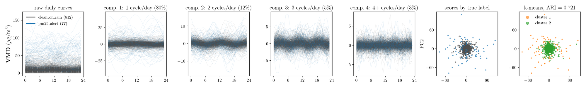

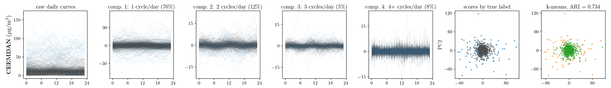

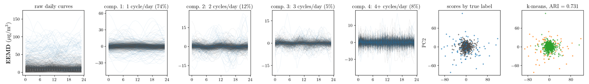

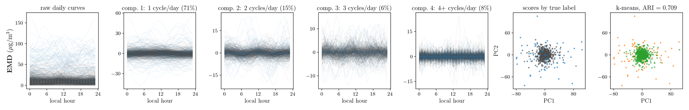

### EPA AQS

**Redlands (California / Riverside-San Bernardino-Ontario, CA)** — O3 · 사건 «AQI USG 이상» 579일 / 대조 «Good · Moderate» 1136일 · ARI — 일평균 최적 문턱 (오라클) 0.582 · FPCA 0.655 · VMD+MFPCA 0.695 · CEEMDAN+MFPCA 0.722 · EEMD+MFPCA 0.662 · EMD+MFPCA 0.710


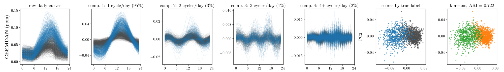

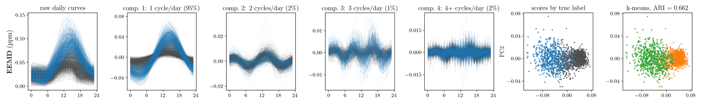


### OpenAQ

**Los Angeles – N. Main (California / Los Angeles-Long Beach-Anaheim, CA)** — PM2.5 · 사건 «AQI USG 이상» 24일 / 대조 «Good · Moderate» 436일 · ARI — 일평균 최적 문턱 (오라클) 0.903 · FPCA 0.203 · VMD+MFPCA 0.203 · CEEMDAN+MFPCA 0.140 · EEMD+MFPCA 0.140 · EMD+MFPCA 0.140

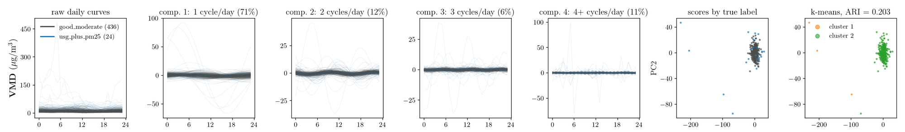

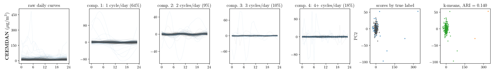

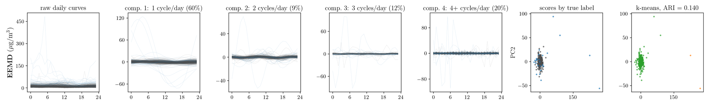

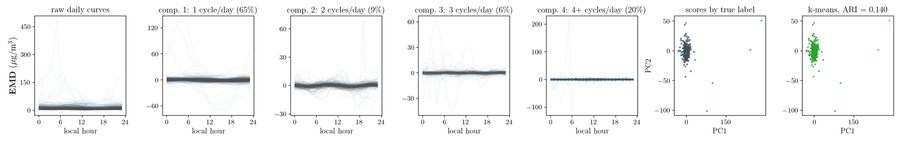

### WEIS

**칠서 (경상남도 · 낙동강 수계)** — DO · 사건 «조류경보» 417일 / 대조 «평상시» 581일 · ARI — 일평균 최적 문턱 (오라클) 0.060 · FPCA 0.045 · VMD+MFPCA 0.054 · CEEMDAN+MFPCA 0.051 · EEMD+MFPCA 0.048 · EMD+MFPCA 0.049

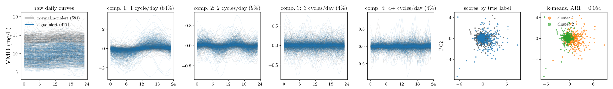

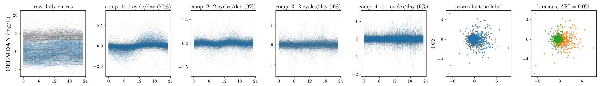

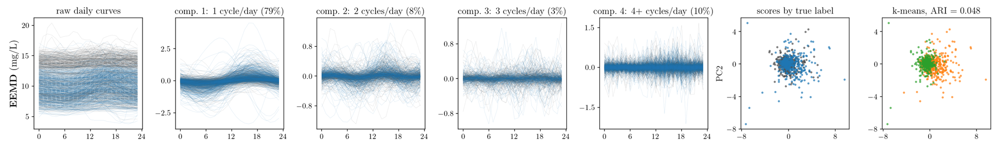

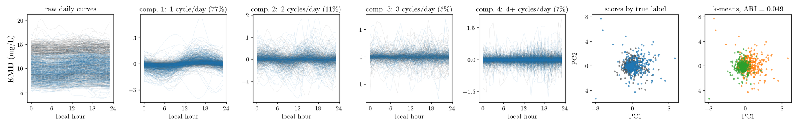

### USGS

**SOUTH RIVER AT FORREST PARK ROAD, AT ATLANTA, GA (Georgia (GA) · Atlanta-Sandy Springs-Roswell, GA 대도시권)** — DO · 사건 «강우 유출 · 홍수 유입» 368일 / 대조 «기저 유출 평수기» 384일 · ARI — 일평균 최적 문턱 (오라클) 0.103 · FPCA 0.077 · VMD+MFPCA 0.075 · CEEMDAN+MFPCA 0.077 · EEMD+MFPCA 0.086 · EMD+MFPCA 0.074

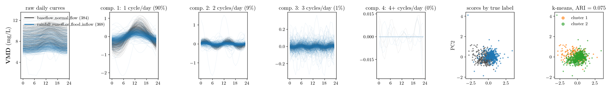

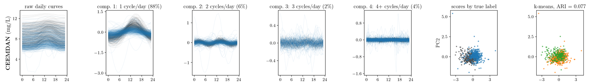


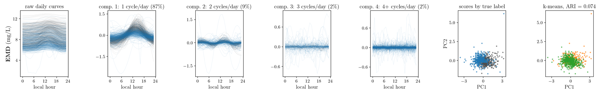

### 기상청 ASOS ①

**대구 (대구광역시)** — 기온 · 사건 «폭염 · 열대야» 226일 / 대조 «비폭염» 1598일 · ARI — 일평균 최적 문턱 (오라클) 0.801 · FPCA 0.082 · VMD+MFPCA -0.004 · CEEMDAN+MFPCA 0.004 · EEMD+MFPCA -0.001 · EMD+MFPCA -0.001

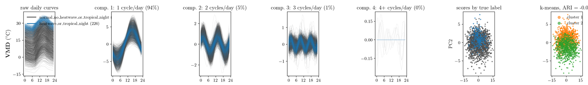

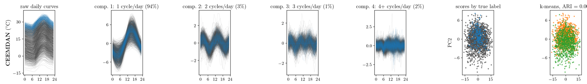

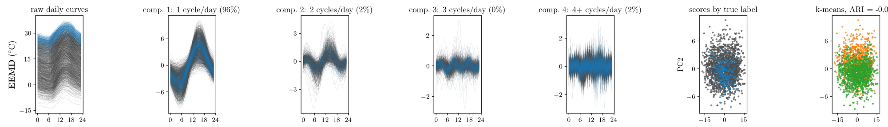

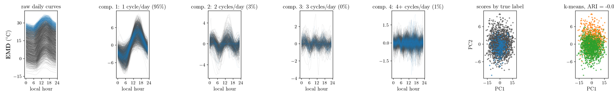

### 기상청 ASOS ②

**광주 (전남광주통합특별시)** — 기온 · 사건 «강우 · 흐림» 699일 / 대조 «맑음» 688일 · ARI — 일평균 최적 문턱 (오라클) 0.032 · FPCA 0.125 · VMD+MFPCA 0.023 · CEEMDAN+MFPCA 0.017 · EEMD+MFPCA 0.010 · EMD+MFPCA 0.006

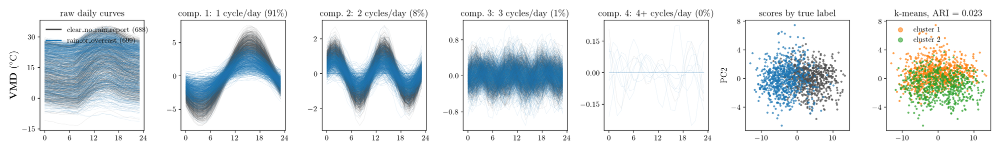

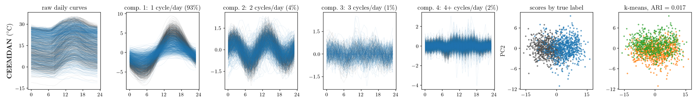


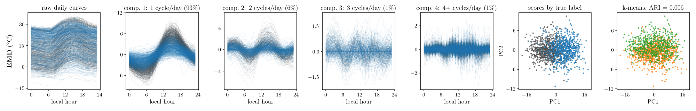

### NOAA ISD

**Portland International (OR / Portland-Vancouver-Hillsboro, OR-WA)** — 기온 · 사건 «한랭 전선 · 강수» 548일 / 대조 «고온 건조» 373일 · ARI — 일평균 최적 문턱 (오라클) 0.874 · FPCA 0.927 · VMD+MFPCA 0.911 · CEEMDAN+MFPCA 0.902 · EEMD+MFPCA 0.911 · EMD+MFPCA 0.919

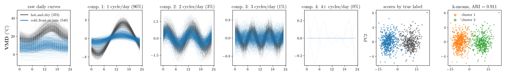

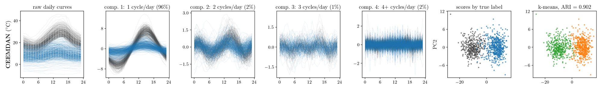

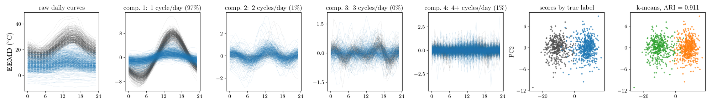

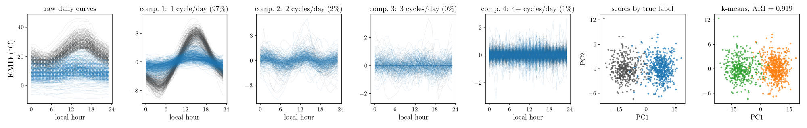

:::

# 4. 어블레이션

`-` 계산한 지점에서 날 · 라벨 · 분해 결과를 그대로 두고 분해+MFPCA 의 부품을 한 번에 하나씩 뺌. 값은 평균 ARI, 괄호는 «그대로» 대비 평균 차. 빨강 = 열마다 가장 높은 것.

## 전체 — 2,101곳

| 바꾼 것 | VMD | CEEMDAN | EEMD | EMD |
|---|---:|---:|---:|---:|
| 그대로 | 0.231 | 0.234 | 0.237 | 0.234 |
| 수준 끄기 | 0.082 (-0.149) | 0.085 (-0.149) | 0.090 (-0.147) | 0.083 (-0.151) |
| 거르기 끄기 | $\color{red}{0.243}$ (+0.012) | $\color{red}{0.248}$ (+0.013) | $\color{red}{0.248}$ (+0.011) | 0.239 (+0.005) |
| 평균 보정 끄기 | 0.158 (-0.073) | 0.222 (-0.012) | 0.227 (-0.010) | 0.198 (-0.036) |
| 분해 끄기 | 0.233 (+0.002) | 0.233 (-0.002) | 0.233 (-0.004) | 0.233 (-0.001) |
| 재배치 끄기 | 0.237 (+0.006) | 0.247 (+0.012) | 0.244 (+0.007) | $\color{red}{0.246}$ (+0.011) |
| 다변량 끄기 | 0.232 (+0.001) | 0.232 (-0.003) | 0.236 (-0.001) | 0.235 (+0.001) |
| 칸 가중치 끄기 | 0.236 (+0.006) | 0.241 (+0.007) | 0.244 (+0.007) | 0.239 (+0.005) |
| 에너지 자르기 끄기 | 0.232 (+0.001) | 0.235 (+0.001) | 0.238 (+0.001) | 0.234 (-0.000) |
| 표준화 끄기 | 0.228 (-0.003) | 0.213 (-0.022) | 0.217 (-0.020) | 0.209 (-0.025) |

- 그대로: 성분마다 이틀보다 느린 변동을 걷어내고 → 주기 칸 → MFPCA, 그 점수에 하루 평균을 더해 k-means
- 수준 끄기: 하루 평균을 안 더함
- 거르기 끄기: 느린 변동을 안 걷어냄 (하루 평균은 더함)
- 평균 보정 끄기: 둘 다 끔 — 옛 설계
- 분해 끄기: 분해 없이 걸러낸 원곡선 FPCA + 하루 평균 (네 열 같음)
- 재배치 끄기: 주기 칸 대신 성분을 그대로 MFPCA
- 다변량 끄기: 1 cycle/day 칸 하나만
- 칸 가중치 끄기: 칸 가중치를 모두 1
- 에너지 자르기 끄기: 성분을 99 % 에서 자르지 않고 전부
- 표준화 끄기: 점수와 하루 평균을 표준화하지 않고 k-means

`-` 전체 평균은 지점이 많은 에어코리아 · EPA · USGS 가 정함 — 자료마다는 아래.

## 자료마다

::: {.panel-tabset}

### 에어코리아 — 655곳

| 바꾼 것 | VMD | CEEMDAN | EEMD | EMD |
|---|---:|---:|---:|---:|
| 그대로 | 0.503 | 0.509 | 0.512 | 0.507 |
| 수준 끄기 | 0.029 (-0.474) | 0.037 (-0.472) | 0.041 (-0.472) | 0.029 (-0.479) |
| 거르기 끄기 | $\color{red}{0.545}$ (+0.043) | $\color{red}{0.601}$ (+0.092) | $\color{red}{0.601}$ (+0.089) | $\color{red}{0.580}$ (+0.073) |
| 평균 보정 끄기 | 0.260 (-0.242) | 0.514 (+0.005) | 0.524 (+0.011) | 0.469 (-0.039) |
| 분해 끄기 | 0.501 (-0.001) | 0.501 (-0.007) | 0.501 (-0.011) | 0.501 (-0.006) |
| 재배치 끄기 | 0.519 (+0.016) | 0.534 (+0.025) | 0.514 (+0.002) | 0.519 (+0.012) |
| 다변량 끄기 | 0.503 (-0.000) | 0.503 (-0.005) | 0.509 (-0.003) | 0.509 (+0.002) |
| 칸 가중치 끄기 | 0.520 (+0.017) | 0.524 (+0.016) | 0.534 (+0.022) | 0.522 (+0.015) |
| 에너지 자르기 끄기 | 0.504 (+0.002) | 0.509 (+0.000) | 0.514 (+0.002) | 0.507 (+0.000) |
| 표준화 끄기 | 0.469 (-0.034) | 0.420 (-0.089) | 0.429 (-0.083) | 0.415 (-0.092) |

### EPA AQS — 815곳

| 바꾼 것 | VMD | CEEMDAN | EEMD | EMD |
|---|---:|---:|---:|---:|
| 그대로 | 0.105 | 0.106 | 0.108 | 0.105 |
| 수준 끄기 | 0.065 (-0.040) | 0.066 (-0.039) | 0.076 (-0.031) | 0.072 (-0.034) |
| 거르기 끄기 | 0.100 (-0.005) | 0.086 (-0.020) | 0.090 (-0.017) | 0.082 (-0.024) |
| 평균 보정 끄기 | 0.077 (-0.028) | 0.074 (-0.032) | 0.083 (-0.025) | 0.061 (-0.044) |
| 분해 끄기 | 0.108 (+0.003) | 0.108 (+0.002) | 0.108 (+0.000) | 0.108 (+0.002) |
| 재배치 끄기 | 0.106 (+0.001) | 0.111 (+0.005) | $\color{red}{0.121}$ (+0.013) | $\color{red}{0.120}$ (+0.015) |
| 다변량 끄기 | 0.109 (+0.004) | 0.103 (-0.002) | 0.107 (-0.000) | 0.106 (+0.001) |
| 칸 가중치 끄기 | 0.105 (+0.000) | 0.109 (+0.003) | 0.105 (-0.002) | 0.107 (+0.001) |
| 에너지 자르기 끄기 | 0.106 (+0.001) | 0.108 (+0.003) | 0.110 (+0.002) | 0.105 (-0.000) |
| 표준화 끄기 | $\color{red}{0.114}$ (+0.009) | $\color{red}{0.112}$ (+0.007) | 0.117 (+0.010) | 0.107 (+0.002) |

### OpenAQ — 2곳

| 바꾼 것 | VMD | CEEMDAN | EEMD | EMD |
|---|---:|---:|---:|---:|
| 그대로 | 0.500 | 0.430 | 0.468 | 0.468 |
| 수준 끄기 | 0.001 (-0.499) | 0.131 (-0.299) | 0.129 (-0.339) | 0.131 (-0.338) |
| 거르기 끄기 | 0.500 (+0.000) | $\color{red}{0.679}$ (+0.249) | $\color{red}{0.558}$ (+0.089) | $\color{red}{0.510}$ (+0.041) |
| 평균 보정 끄기 | 0.244 (-0.256) | 0.335 (-0.095) | 0.480 (+0.012) | 0.402 (-0.067) |
| 분해 끄기 | 0.430 (-0.070) | 0.430 (+0.000) | 0.430 (-0.038) | 0.430 (-0.038) |
| 재배치 끄기 | $\color{red}{0.558}$ (+0.058) | 0.429 (-0.001) | 0.458 (-0.010) | 0.474 (+0.006) |
| 다변량 끄기 | 0.530 (+0.030) | 0.430 (+0.000) | 0.468 (+0.000) | 0.468 (+0.000) |
| 칸 가중치 끄기 | 0.530 (+0.030) | 0.396 (-0.034) | 0.435 (-0.034) | 0.490 (+0.022) |
| 에너지 자르기 끄기 | 0.500 (+0.000) | 0.413 (-0.017) | 0.468 (+0.000) | 0.468 (+0.000) |
| 표준화 끄기 | 0.462 (-0.038) | 0.413 (-0.017) | 0.413 (-0.056) | 0.397 (-0.071) |

### WEIS — 9곳

| 바꾼 것 | VMD | CEEMDAN | EEMD | EMD |
|---|---:|---:|---:|---:|
| 그대로 | 0.062 | 0.062 | 0.054 | 0.058 |
| 수준 끄기 | $\color{red}{0.158}$ (+0.096) | $\color{red}{0.147}$ (+0.085) | $\color{red}{0.145}$ (+0.092) | $\color{red}{0.152}$ (+0.093) |
| 거르기 끄기 | 0.062 (+0.000) | 0.037 (-0.026) | 0.032 (-0.021) | 0.032 (-0.027) |
| 평균 보정 끄기 | 0.133 (+0.071) | 0.044 (-0.019) | 0.033 (-0.020) | 0.026 (-0.033) |
| 분해 끄기 | 0.065 (+0.002) | 0.065 (+0.002) | 0.065 (+0.011) | 0.065 (+0.006) |
| 재배치 끄기 | 0.067 (+0.005) | 0.066 (+0.004) | 0.098 (+0.045) | 0.062 (+0.004) |
| 다변량 끄기 | 0.062 (+0.000) | 0.061 (-0.001) | 0.054 (+0.000) | 0.059 (+0.000) |
| 칸 가중치 끄기 | 0.060 (-0.003) | 0.061 (-0.001) | 0.053 (-0.000) | 0.059 (+0.001) |
| 에너지 자르기 끄기 | 0.061 (-0.001) | 0.062 (-0.000) | 0.054 (+0.000) | 0.058 (-0.001) |
| 표준화 끄기 | 0.035 (-0.028) | 0.035 (-0.028) | 0.035 (-0.019) | 0.036 (-0.023) |

### USGS — 549곳

| 바꾼 것 | VMD | CEEMDAN | EEMD | EMD |
|---|---:|---:|---:|---:|
| 그대로 | 0.093 | 0.097 | 0.097 | 0.097 |
| 수준 끄기 | $\color{red}{0.140}$ (+0.047) | $\color{red}{0.140}$ (+0.044) | $\color{red}{0.133}$ (+0.036) | $\color{red}{0.134}$ (+0.036) |
| 거르기 끄기 | 0.095 (+0.002) | 0.076 (-0.021) | 0.072 (-0.026) | 0.073 (-0.024) |
| 평균 보정 끄기 | 0.134 (+0.041) | 0.096 (-0.001) | 0.088 (-0.009) | 0.078 (-0.020) |
| 분해 끄기 | 0.097 (+0.004) | 0.097 (+0.000) | 0.097 (-0.001) | 0.097 (-0.001) |
| 재배치 끄기 | 0.093 (+0.000) | 0.101 (+0.005) | 0.105 (+0.008) | 0.102 (+0.005) |
| 다변량 끄기 | 0.093 (-0.000) | 0.097 (+0.000) | 0.097 (-0.000) | 0.097 (-0.000) |
| 칸 가중치 끄기 | 0.091 (-0.002) | 0.098 (+0.002) | 0.102 (+0.005) | 0.097 (-0.000) |
| 에너지 자르기 끄기 | 0.093 (-0.000) | 0.095 (-0.002) | 0.096 (-0.001) | 0.097 (-0.000) |
| 표준화 끄기 | 0.112 (+0.019) | 0.116 (+0.020) | 0.109 (+0.012) | 0.114 (+0.017) |

### 기상청 ASOS ① — 7곳

| 바꾼 것 | VMD | CEEMDAN | EEMD | EMD |
|---|---:|---:|---:|---:|
| 그대로 | -0.023 | -0.019 | -0.020 | -0.017 |
| 수준 끄기 | -0.009 (+0.013) | 0.002 (+0.021) | 0.001 (+0.021) | -0.003 (+0.014) |
| 거르기 끄기 | -0.026 (-0.004) | 0.005 (+0.024) | -0.000 (+0.020) | 0.002 (+0.019) |
| 평균 보정 끄기 | $\color{red}{0.001}$ (+0.024) | $\color{red}{0.073}$ (+0.092) | $\color{red}{0.073}$ (+0.093) | $\color{red}{0.045}$ (+0.062) |
| 분해 끄기 | -0.015 (+0.008) | -0.015 (+0.004) | -0.015 (+0.005) | -0.015 (+0.002) |
| 재배치 끄기 | -0.023 (-0.001) | -0.012 (+0.007) | -0.022 (-0.002) | -0.018 (-0.001) |
| 다변량 끄기 | -0.023 (+0.000) | -0.020 (-0.000) | -0.021 (-0.001) | -0.018 (-0.001) |
| 칸 가중치 끄기 | -0.000 (+0.022) | -0.021 (-0.002) | -0.024 (-0.004) | -0.011 (+0.006) |
| 에너지 자르기 끄기 | -0.023 (+0.000) | -0.021 (-0.001) | -0.023 (-0.003) | -0.016 (+0.000) |
| 표준화 끄기 | -0.001 (+0.022) | -0.000 (+0.019) | -0.002 (+0.018) | -0.000 (+0.017) |

### 기상청 ASOS ② — 7곳

| 바꾼 것 | VMD | CEEMDAN | EEMD | EMD |
|---|---:|---:|---:|---:|
| 그대로 | 0.041 | 0.037 | 0.028 | 0.035 |
| 수준 끄기 | 0.413 (+0.371) | $\color{red}{0.386}$ (+0.349) | $\color{red}{0.299}$ (+0.271) | $\color{red}{0.296}$ (+0.261) |
| 거르기 끄기 | 0.035 (-0.006) | 0.048 (+0.011) | 0.050 (+0.021) | 0.049 (+0.014) |
| 평균 보정 끄기 | $\color{red}{0.413}$ (+0.371) | 0.199 (+0.163) | 0.188 (+0.160) | 0.162 (+0.127) |
| 분해 끄기 | 0.052 (+0.011) | 0.052 (+0.016) | 0.052 (+0.024) | 0.052 (+0.017) |
| 재배치 끄기 | 0.042 (+0.000) | 0.062 (+0.026) | 0.054 (+0.025) | 0.094 (+0.059) |
| 다변량 끄기 | 0.039 (-0.002) | 0.037 (+0.000) | 0.027 (-0.001) | 0.035 (-0.000) |
| 칸 가중치 끄기 | 0.069 (+0.027) | 0.044 (+0.007) | 0.057 (+0.029) | 0.069 (+0.033) |
| 에너지 자르기 끄기 | 0.041 (-0.000) | 0.038 (+0.002) | 0.028 (-0.001) | 0.036 (+0.001) |
| 표준화 끄기 | 0.053 (+0.012) | 0.058 (+0.022) | 0.052 (+0.023) | 0.060 (+0.025) |

### NOAA ISD — 57곳

| 바꾼 것 | VMD | CEEMDAN | EEMD | EMD |
|---|---:|---:|---:|---:|
| 그대로 | 0.307 | 0.328 | 0.348 | 0.330 |
| 수준 끄기 | 0.344 (+0.037) | 0.342 (+0.013) | $\color{red}{0.426}$ (+0.078) | $\color{red}{0.366}$ (+0.036) |
| 거르기 끄기 | 0.311 (+0.004) | 0.227 (-0.102) | 0.228 (-0.120) | 0.228 (-0.102) |
| 평균 보정 끄기 | $\color{red}{0.358}$ (+0.051) | 0.255 (-0.073) | 0.269 (-0.079) | 0.263 (-0.067) |
| 분해 끄기 | 0.318 (+0.011) | 0.318 (-0.010) | 0.318 (-0.030) | 0.318 (-0.012) |
| 재배치 끄기 | 0.307 (-0.001) | $\color{red}{0.359}$ (+0.031) | 0.323 (-0.025) | 0.352 (+0.021) |
| 다변량 끄기 | 0.306 (-0.001) | 0.327 (-0.001) | 0.348 (-0.000) | 0.331 (+0.000) |
| 칸 가중치 끄기 | 0.318 (+0.011) | 0.328 (-0.001) | 0.348 (-0.000) | 0.328 (-0.002) |
| 에너지 자르기 끄기 | 0.307 (-0.000) | 0.328 (-0.000) | 0.347 (-0.001) | 0.330 (-0.001) |
| 표준화 끄기 | 0.263 (-0.044) | 0.272 (-0.057) | 0.290 (-0.058) | 0.277 (-0.053) |

:::

---

계산 — 지점마다 통째 신호를 분해한 뒤 오라클 · FPCA · 분해+MFPCA 를 돌림 (R, 리포트 1 과 같은 코드 · `261014_하모니_실자료전체.R` · 어블레이션 `261014_하모니_어블레이션.R`). 3절 그림 `261014_아리아_실자료4x7그림.py --tag 교수님라벨_전지점` (아리아). 지도 밑그림은 Natural Earth (world-atlas 2.0.2 · us-atlas 3.0.1).
