# 1. 진행사항

`-` EBT 는 폐기.

`-` 제안 문서 (`Real_Data_DecompFPCA.docx`) 의 자료 여덟 가지에 리포트 1 (vic_elec) 의 절차를 그대로 돌림.


# 2. 자료와 라벨

| 자료         | 문서의 라벨                                     | 판정 규칙                                                                                                                               |
| ---------- | ------------------------------------------ | ----------------------------------------------------------------------------------------------------------------------------------- |
| 에어코리아      | 대기 정체 · 고농도 미세먼지 주의보 발령일 vs 청정 대기 확산 · 강수일 | 1 = 지점이 속한 권역에 PM2.5 주의보 · 경보가 걸친 날 / 0 = 그 밖의 날 중 그 권역의 PM2.5 예보 (당일 최종 발표) 가 «좋음» 이거나 가장 가까운 ASOS 일강수 ≥ 1 mm 인 날                  |
| EPA AQS · PM2.5 | AQI USG 이상 vs Good · Moderate | 1 = 카운티 일 AQI ≥ 101 이고 그날 AQI 를 정한 물질이 PM2.5 인 날 / 0 = 카운티 일 AQI 가 Good · Moderate 인 날 |
| EPA AQS · O3 | AQI USG 이상 vs Good · Moderate | 1 = 카운티 일 AQI ≥ 101 이고 그날 AQI 를 정한 물질이 O3 인 날 / 0 = 카운티 일 AQI 가 Good · Moderate 인 날 |
| OpenAQ     | (라벨 없음)                                    | LA: EPA 규칙 (LA 카운티 · PM2.5) / 서울 종로구: 에어코리아 규칙                                                                                      |
| WEIS       | 조류경보제 발령 기간 vs 평상시 정상일                     | 1 = 대응하는 조류경보 지점에 경보 (관심 이상) 가 걸린 날 / 0 = 경보가 아님이 확인된 날 (모든 달). 대응하는 경보 지점이 없는 곳은 라벨 없음                                             |
| USGS       | 강우 유출 · 홍수 유입일 vs 기저 유출 평수기                | 일유량 Q 를 Lyne–Hollick 필터 (α 0.925, 앞 · 뒤 · 앞) 로 기저 유출과 직접 유출 D 로 나눔. 1 = D / Q ≥ 0.5 인 날 / 0 = D / Q ≤ 0.1 이고 Q 가 지점의 P25 – P75 안인 날 |
| 기상청 ASOS ① | 폭염 · 열대야 발생일 vs 비폭염 정상일                    | 1 = 기상청 공식 폭염일 (일최고 ≥ 33 °C) 또는 열대야일 (18:01 – 익일 09:00 최저 ≥ 25 °C) / 0 = 둘 다 아닌 날                                                   |
| 기상청 ASOS ② | 청명일 (맑음) vs 강우 · 운량 8 이상 흐린 날              | 1 = 일강수 ≥ 0.1 mm 이거나 일평균 전운량 ≥ 8 인 날 / 0 = 일평균 전운량 0 – 5 (기상청 하늘상태 «맑음») 이고 강수 보고가 없는 날                                             |
| NOAA ISD   | 고온 건조 기후일 vs 한랭 전선 통과 · 강수일                | 1 = 강수 ≥ 1 mm 이거나 한랭 전선이 지난 날 (일평균 기온이 전날보다 5 °C 이상 내리고 일평균 해면기압이 3 hPa 이상 오름) / 0 = 강수 0 이고 일최고 ≥ 지점 P75 · 일평균 습도 ≤ 지점 중앙값인 날      |

<!-- colwidths: 6.850962 8.052885 8.894231 -->

# 3. 성능 비교 — 지점별

::: {.panel-tabset}

## 에어코리아

| | 일평균 최적 (오라클) | FPCA | VMD+MFPCA | CEEMDAN+MFPCA | EEMD+MFPCA | EMD+MFPCA |
|---|---:|---:|---:|---:|---:|---:|
| **평균** | $\color{red}{0.796}$ | 0.512 | 0.515 | 0.518 | 0.525 | 0.500 |
| 중앙값 | $\color{red}{0.801}$ | 0.695 | 0.690 | 0.688 | 0.694 | 0.681 |
| 아래 25% | $\color{red}{0.764}$ | 0.057 | 0.062 | 0.076 | 0.090 | 0.060 |
| 위 25% | $\color{red}{0.835}$ | 0.761 | 0.760 | 0.760 | 0.761 | 0.753 |

::: {layout="[[62,38]]"}
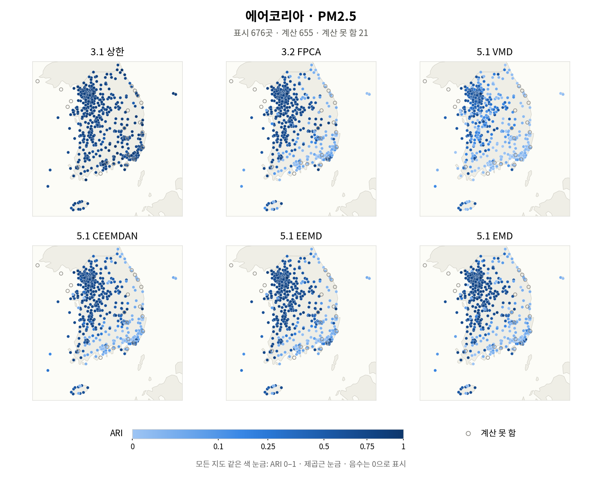

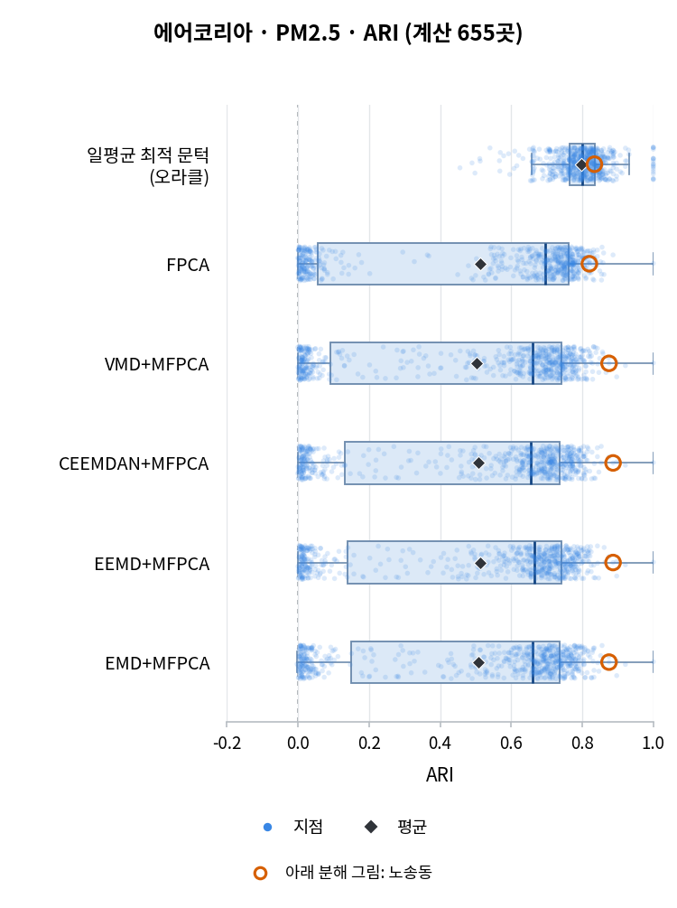
:::

```{ojs}
//| echo: false
decPick("airkorea")
```

## EPA AQS · PM2.5

| | 일평균 최적 (오라클) | FPCA | VMD+MFPCA | CEEMDAN+MFPCA | EEMD+MFPCA | EMD+MFPCA |
|---|---:|---:|---:|---:|---:|---:|
| **평균** | $\color{red}{0.801}$ | 0.130 | 0.144 | 0.142 | 0.142 | 0.119 |
| 중앙값 | $\color{red}{0.875}$ | 0.035 | 0.031 | 0.033 | 0.034 | 0.025 |
| 아래 25% | $\color{red}{0.665}$ | 0.010 | 0.010 | 0.011 | 0.010 | 0.007 |
| 위 25% | $\color{red}{1.000}$ | 0.170 | 0.173 | 0.180 | 0.165 | 0.141 |

::: {layout="[[62,38]]"}
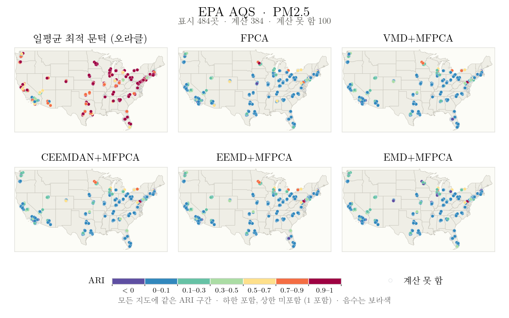

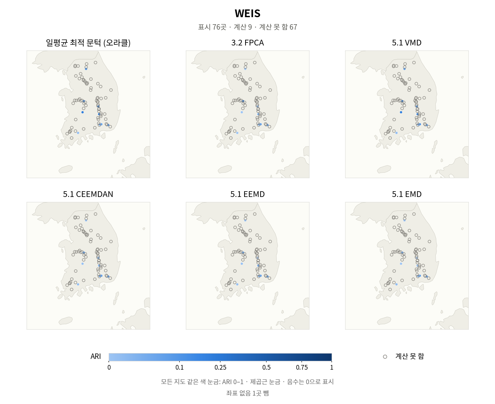
:::

```{ojs}
//| echo: false
decPick("epa_pm25")
```

## EPA AQS · O3

| | 일평균 최적 (오라클) | FPCA | VMD+MFPCA | CEEMDAN+MFPCA | EEMD+MFPCA | EMD+MFPCA |
|---|---:|---:|---:|---:|---:|---:|
| **평균** | $\color{red}{0.440}$ | 0.027 | 0.033 | 0.028 | 0.038 | 0.032 |
| 중앙값 | $\color{red}{0.437}$ | 0.002 | 0.002 | 0.001 | 0.005 | 0.003 |
| 아래 25% | $\color{red}{0.300}$ | -0.001 | -0.001 | -0.001 | -0.000 | -0.001 |
| 위 25% | $\color{red}{0.569}$ | 0.015 | 0.016 | 0.013 | 0.025 | 0.021 |

::: {layout="[[62,38]]"}
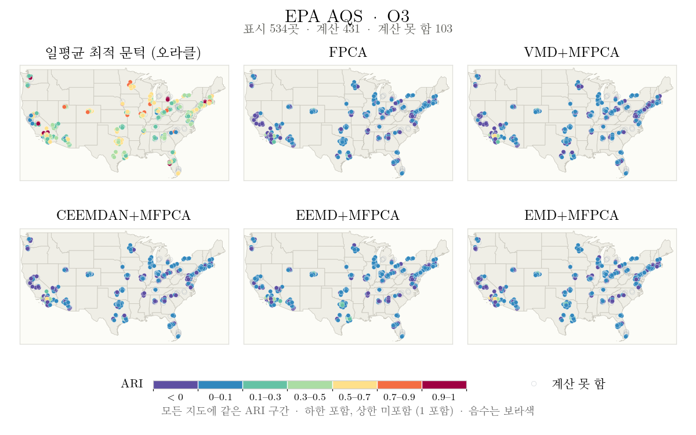

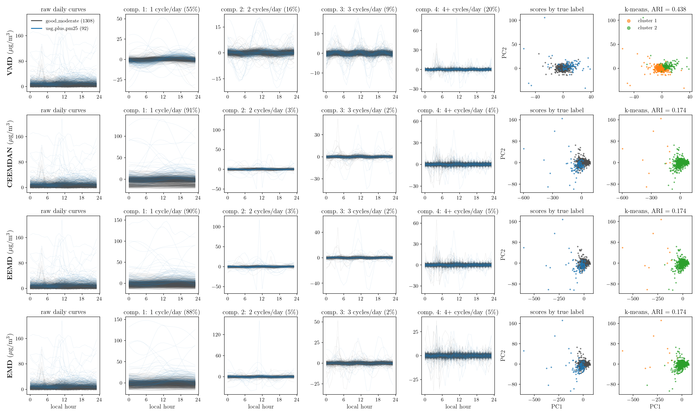
:::

```{ojs}
//| echo: false
decPick("epa_o3")
```

## OpenAQ

| 지역 | 지점 | 물질 | 1 / 0 (일) | 일평균 최적 (오라클) | FPCA | VMD+MFPCA | CEEMDAN+MFPCA | EEMD+MFPCA | EMD+MFPCA |
|---|---|---|---:|---:|---:|---:|---:|---:|---:|
| **평균** | | | | $\color{red}{0.878}$ | 0.419 | 0.480 | 0.480 | 0.480 | 0.480 |
| California / Los Angeles-Long Beach-Anaheim, CA | Los Angeles – N. Main | PM2.5 | 24 / 436 | $\color{red}{0.903}$ | 0.203 | 0.203 | 0.203 | 0.203 | 0.203 |
| 서울특별시 | 서울 종로구 | PM2.5 | 11 / 258 | $\color{red}{0.853}$ | 0.635 | 0.757 | 0.757 | 0.757 | 0.757 |

```{ojs}
//| echo: false
decPick("openaq")
```

## WEIS

| 지역 | 지점 | 1 / 0 (일) | 일평균 최적 (오라클) | FPCA | VMD+MFPCA | CEEMDAN+MFPCA | EEMD+MFPCA | EMD+MFPCA |
|---|---|---:|---:|---:|---:|---:|---:|---:|
| **평균** | | | 0.163 | 0.064 | 0.039 | 0.030 | 0.042 | 0.032 |
| 강원특별자치도 · 한강 수계 | 의암호 | 20 / 907 | 0.109 | -0.009 | -0.009 | -0.009 | -0.009 | -0.009 |
| 경상남도 · 낙동강 수계 | 상동 | 312 / 520 | 0.119 | 0.082 | 0.079 | -0.010 | 0.082 | 0.081 |
| 경상남도 · 낙동강 수계 | 청암 | 382 / 575 | 0.055 | 0.064 | 0.062 | 0.067 | 0.062 | 0.066 |
| 경상남도 · 낙동강 수계 | 칠서 | 417 / 581 | 0.060 | 0.045 | 0.041 | 0.048 | 0.048 | 0.043 |
| 경상북도 · 낙동강 수계 | 다산 | 179 / 646 | $\color{red}{0.269}$ | 0.027 | 0.038 | 0.033 | 0.052 | 0.012 |
| 경상북도 · 낙동강 수계 | 해평 | 142 / 784 | $\color{red}{0.353}$ | 0.015 | 0.017 | 0.010 | 0.038 | 0.004 |
| 전라남도 · 영산·섬진 수계 | 주암호 | 14 / 996 | 0.002 | 0.000 | 0.000 | 0.112 | 0.001 | 0.000 |
| 전북특별자치도 · 금강 수계 | 용담호 | 71 / 1074 | $\color{red}{0.216}$ | -0.001 | 0.000 | -0.009 | 0.001 | 0.001 |
| 충청북도 · 금강 수계 | 대청호 | 178 / 986 | 0.280 | $\color{red}{0.357}$ | 0.118 | 0.026 | 0.105 | 0.088 |

::: {layout="[[62,38]]"}
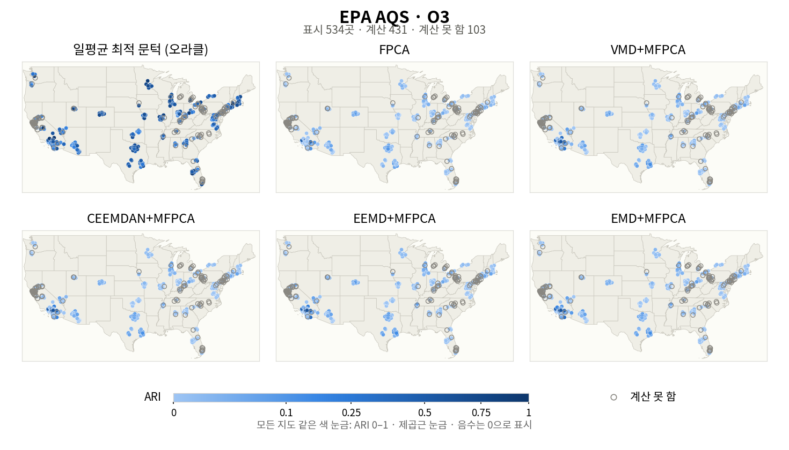

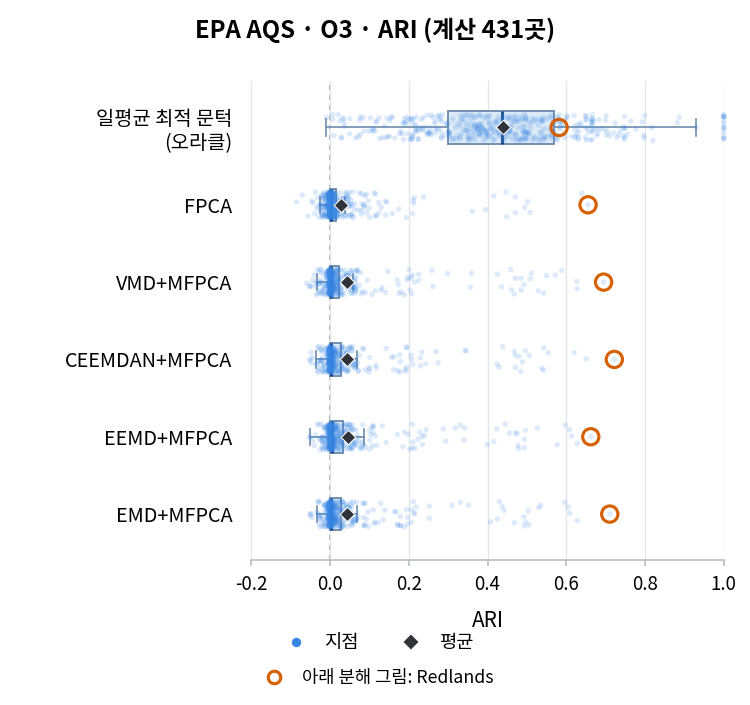
:::

```{ojs}
//| echo: false
decPick("weis")
```

## USGS

| | 일평균 최적 (오라클) | FPCA | VMD+MFPCA | CEEMDAN+MFPCA | EEMD+MFPCA | EMD+MFPCA |
|---|---:|---:|---:|---:|---:|---:|
| **평균** | $\color{red}{0.214}$ | 0.095 | 0.082 | 0.074 | 0.089 | 0.076 |
| 중앙값 | 0.173 | 0.028 | 0.019 | 0.017 | 0.023 | 0.024 |
| 아래 25% | 0.085 | 0.000 | -0.002 | -0.002 | 0.000 | -0.001 |
| 위 25% | $\color{red}{0.307}$ | 0.117 | 0.096 | 0.083 | 0.113 | 0.088 |

::: {layout="[[62,38]]"}
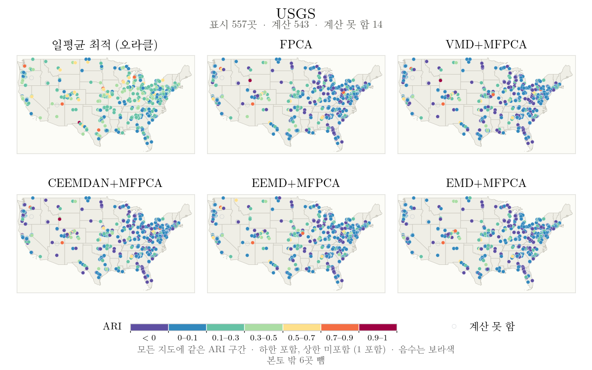

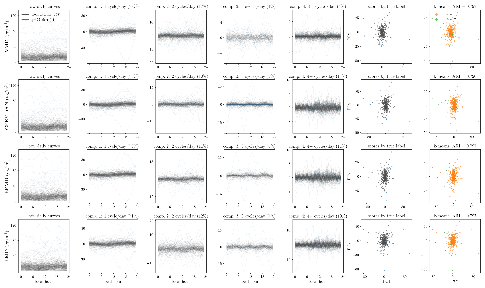
:::

```{ojs}
//| echo: false
decPick("usgs")
```

## 기상청 ASOS ①

| 지역 | 지점 | 1 / 0 (일) | 일평균 최적 (오라클) | FPCA | VMD+MFPCA | CEEMDAN+MFPCA | EEMD+MFPCA | EMD+MFPCA |
|---|---|---:|---:|---:|---:|---:|---:|---:|
| **평균** | | | $\color{red}{0.798}$ | 0.059 | 0.086 | 0.061 | 0.051 | 0.048 |
| 대구광역시 | 대구 | 226 / 1598 | $\color{red}{0.801}$ | 0.082 | 0.099 | 0.095 | 0.072 | 0.079 |
| 대전광역시 | 대전 | 179 / 1644 | $\color{red}{0.833}$ | 0.053 | 0.080 | 0.056 | 0.059 | 0.040 |
| 부산광역시 | 부산 | 188 / 1637 | $\color{red}{0.866}$ | 0.086 | 0.098 | 0.056 | 0.073 | 0.071 |
| 서울특별시 | 서울 | 186 / 1640 | $\color{red}{0.807}$ | 0.064 | 0.116 | 0.095 | -0.018 | 0.055 |
| 울산광역시 | 울산 | 105 / 1721 | $\color{red}{0.706}$ | 0.022 | 0.035 | 0.023 | 0.025 | 0.023 |
| 인천광역시 | 인천 | 150 / 1676 | $\color{red}{0.799}$ | 0.061 | 0.075 | 0.050 | 0.053 | 0.044 |
| 전남광주통합특별시 | 광주 | 181 / 1642 | $\color{red}{0.775}$ | 0.046 | 0.100 | 0.050 | 0.089 | 0.024 |

::: {layout="[[62,38]]"}
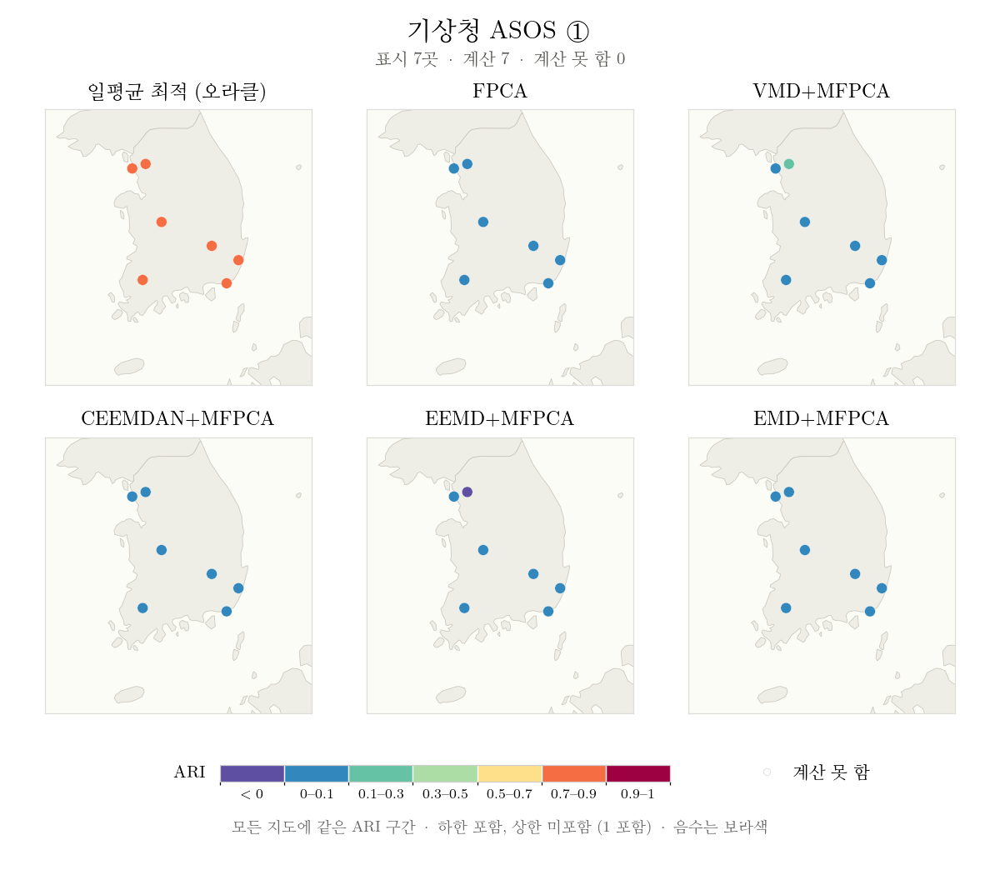

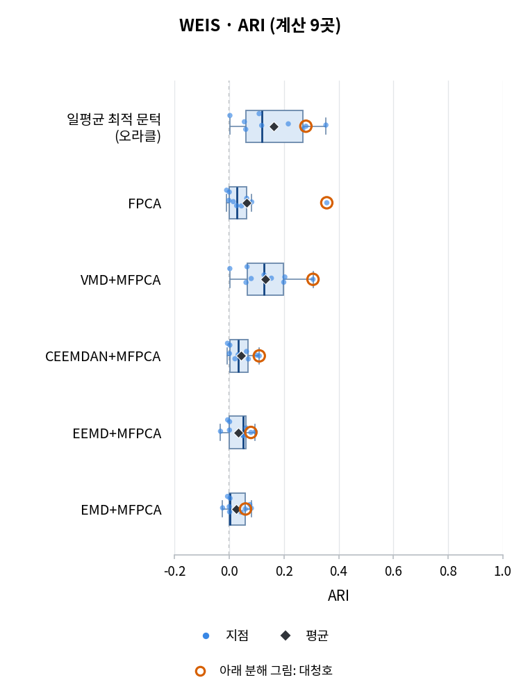
:::

```{ojs}
//| echo: false
decPick("asos1")
```

## 기상청 ASOS ②

| 지역 | 지점 | 1 / 0 (일) | 일평균 최적 (오라클) | FPCA | VMD+MFPCA | CEEMDAN+MFPCA | EEMD+MFPCA | EMD+MFPCA |
|---|---|---:|---:|---:|---:|---:|---:|---:|
| **평균** | | | 0.066 | 0.192 | 0.190 | 0.194 | 0.180 | 0.160 |
| 대구광역시 | 대구 | 575 / 851 | 0.084 | 0.228 | $\color{red}{0.239}$ | 0.231 | 0.230 | 0.219 |
| 대전광역시 | 대전 | 646 / 742 | 0.040 | 0.117 | 0.146 | 0.124 | 0.139 | 0.106 |
| 부산광역시 | 부산 | 579 / 877 | 0.088 | 0.217 | 0.203 | $\color{red}{0.245}$ | 0.206 | 0.202 |
| 서울특별시 | 서울 | 654 / 786 | 0.061 | $\color{red}{0.225}$ | 0.198 | 0.208 | 0.191 | 0.148 |
| 울산광역시 | 울산 | 586 / 857 | 0.088 | 0.266 | 0.264 | $\color{red}{0.271}$ | 0.203 | 0.217 |
| 인천광역시 | 인천 | 597 / 781 | 0.070 | 0.167 | 0.154 | 0.152 | 0.156 | 0.134 |
| 전남광주통합특별시 | 광주 | 699 / 688 | 0.032 | 0.125 | 0.128 | 0.125 | 0.136 | 0.092 |

::: {layout="[[62,38]]"}
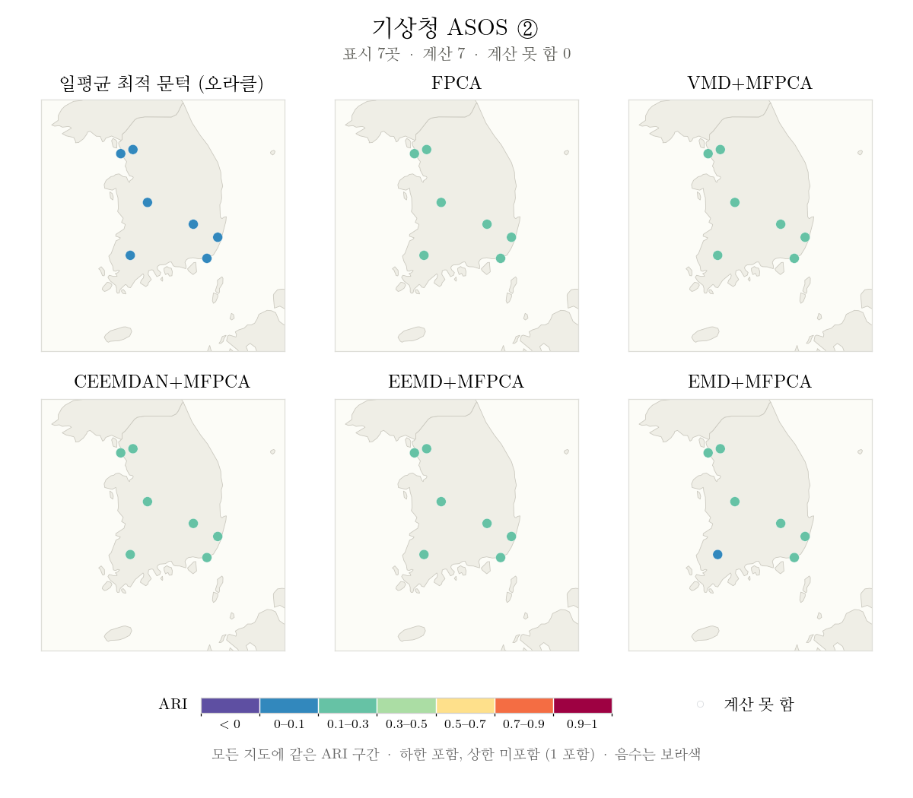

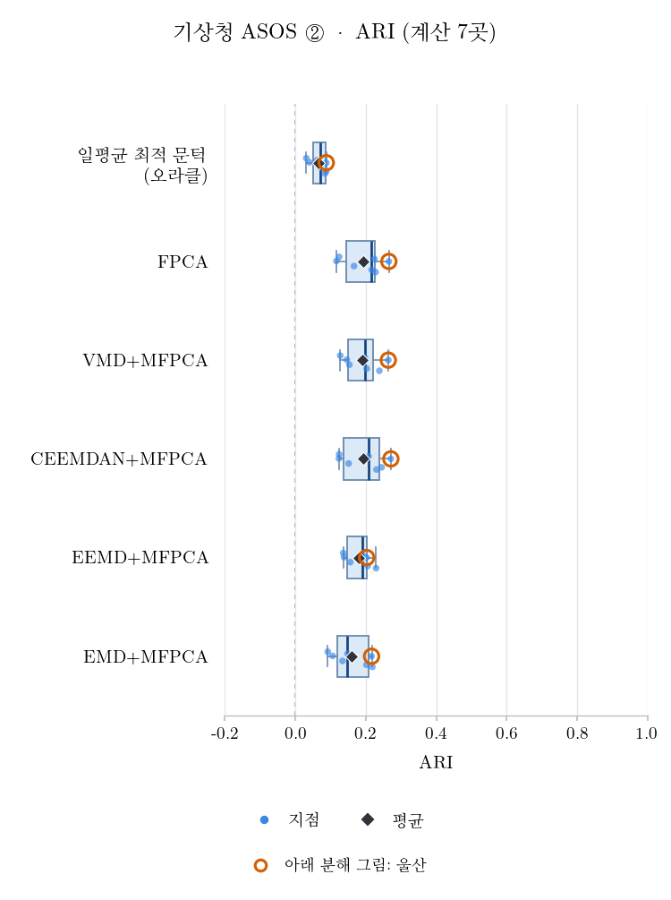
:::

```{ojs}
//| echo: false
decPick("asos2")
```

## NOAA ISD

| | 일평균 최적 (오라클) | FPCA | VMD+MFPCA | CEEMDAN+MFPCA | EEMD+MFPCA | EMD+MFPCA |
|---|---:|---:|---:|---:|---:|---:|
| **평균** | $\color{red}{0.504}$ | 0.253 | 0.239 | 0.129 | 0.271 | 0.177 |
| 중앙값 | $\color{red}{0.401}$ | 0.097 | 0.086 | 0.029 | 0.092 | 0.059 |
| 아래 25% | $\color{red}{0.341}$ | 0.039 | 0.027 | -0.001 | 0.036 | -0.001 |
| 위 25% | $\color{red}{0.651}$ | 0.324 | 0.322 | 0.104 | 0.452 | 0.151 |

::: {layout="[[62,38]]"}
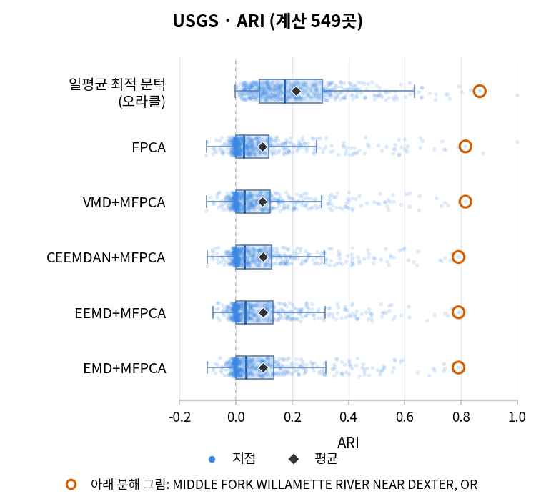

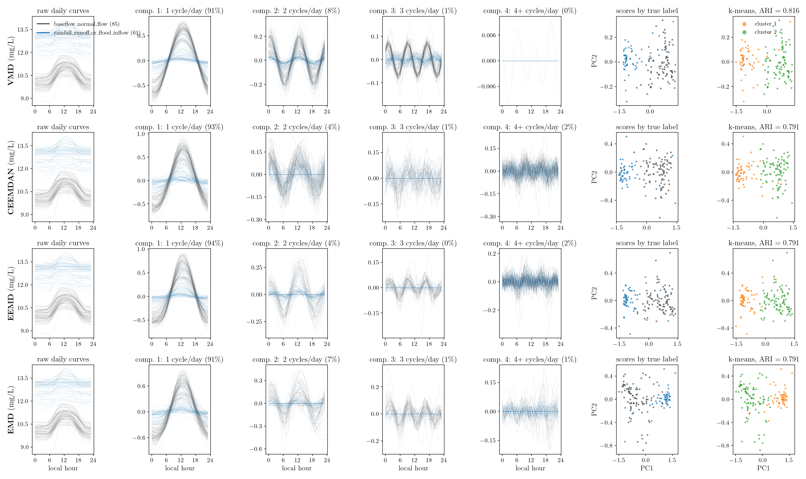
:::

```{ojs}
//| echo: false
decPick("isd")
```

:::

# 4. 어블레이션

`-` 표의 줄 — Full model 에서 부품을 하나씩 뺌 (w/o = without). 값은 평균 ARI, 괄호는 Full model 과의 차.

`-` 탭마다 표 · 그림 (자료 평균) 아래에 지점별 — 지점마다 바꾼 뒤 ARI − Full model ARI 를 네 분해로 평균한 값 (지도 · 상자, 작은 자료는 표).

- Full model: 분해 성분 (느린 변동까지 — VMD 는 DC 모드, EMD 계열은 마지막 잔차) 을 에너지 큰 것부터 99 % 까지 남기고, 날마다 성분을 지배주파수에 따라 1 · 2 · 3 · 4+ cycles/day 칸 (band) 에 모아 더한 뒤 칸 에너지를 가중치로 MFPCA (점수 3개) → 점수를 표준화해 k-means (k = 2). 하루 평균은 더하지 않음
- w/o decomposition: 분해 없이 하루 원곡선을 FPCA (= 3절 FPCA — 네 분해 열이 같은 값)
- w/o band regrouping: 성분을 주파수 칸에 모으지 않고 성분 하나하나를 그대로 MFPCA 변수로 (가중치는 성분 에너지)
- w/o band weighting: MFPCA 의 칸 가중치를 모두 1
- w/o energy truncation: 99 % 에서 자르지 않고 성분을 전부 넣음
- w/o score standardization: MFPCA 점수를 표준화하지 않고 바로 k-means

::: {.panel-tabset}

## 에어코리아

| 바꾼 것 | VMD | CEEMDAN | EEMD | EMD |
|---|---:|---:|---:|---:|
| Full model | 0.515 | 0.518 | 0.525 | 0.500 |
| **w/o decomposition** | 0.512 (-0.003) | 0.512 (-0.006) | 0.512 (-0.013) | 0.512 (+0.012) |
| w/o band regrouping | 0.437 (-0.078) | 0.045 (-0.473) | 0.065 (-0.461) | 0.037 (-0.463) |
| w/o band weighting | 0.514 (-0.001) | 0.499 (-0.019) | 0.527 (+0.002) | 0.489 (-0.011) |
| w/o energy truncation | 0.515 (-0.000) | 0.517 (-0.001) | 0.525 (-0.001) | 0.512 (+0.013) |
| w/o score standardization | 0.596 (+0.081) | 0.594 (+0.076) | 0.596 (+0.071) | 0.566 (+0.067) |

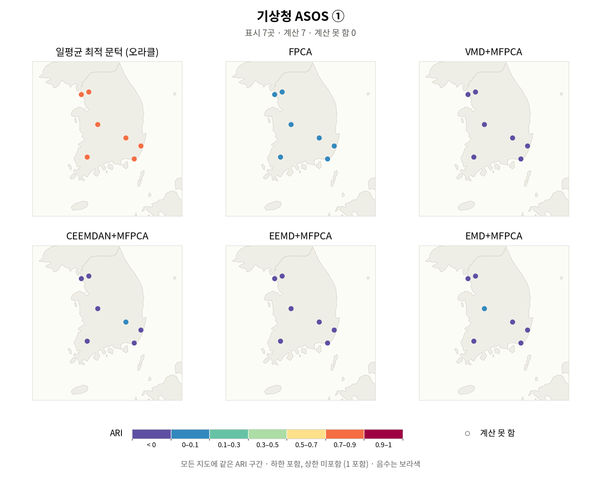

::: {layout="[[62,38]]"}
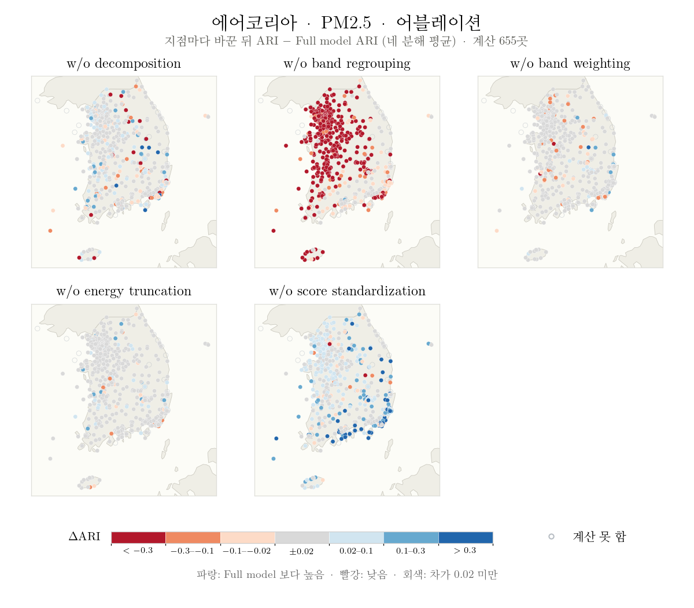


:::


## EPA AQS · PM2.5

| 바꾼 것 | VMD | CEEMDAN | EEMD | EMD |
|---|---:|---:|---:|---:|
| Full model | 0.144 | 0.142 | 0.142 | 0.119 |
| **w/o decomposition** | 0.130 (-0.013) | 0.130 (-0.011) | 0.130 (-0.011) | 0.130 (+0.012) |
| w/o band regrouping | 0.137 (-0.007) | 0.048 (-0.093) | 0.072 (-0.069) | 0.059 (-0.059) |
| w/o band weighting | 0.146 (+0.003) | 0.130 (-0.011) | 0.145 (+0.003) | 0.109 (-0.009) |
| w/o energy truncation | 0.145 (+0.001) | 0.146 (+0.004) | 0.142 (-0.000) | 0.131 (+0.012) |
| w/o score standardization | 0.157 (+0.013) | 0.167 (+0.025) | 0.168 (+0.026) | 0.148 (+0.030) |

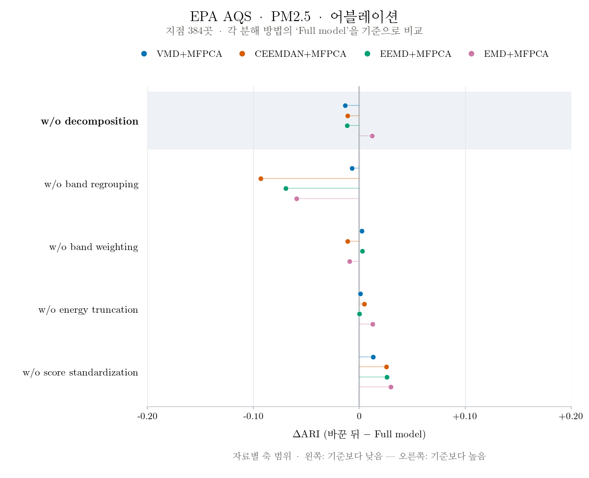

::: {layout="[[62,38]]"}
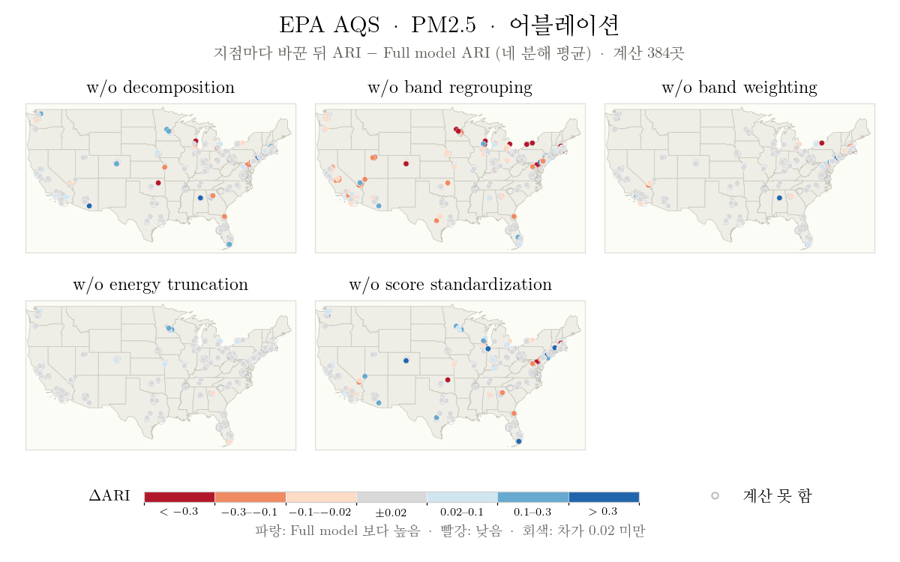

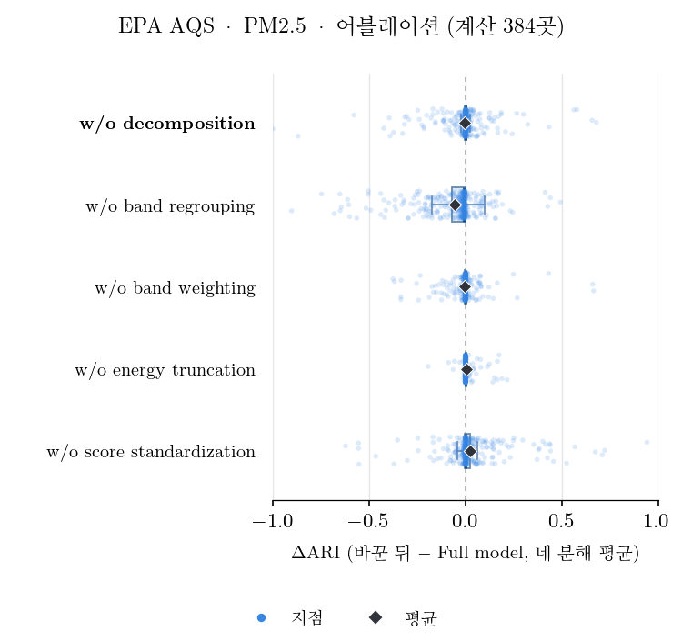
:::


## EPA AQS · O3

| 바꾼 것 | VMD | CEEMDAN | EEMD | EMD |
|---|---:|---:|---:|---:|
| Full model | 0.033 | 0.028 | 0.038 | 0.032 |
| **w/o decomposition** | 0.027 (-0.007) | 0.027 (-0.001) | 0.027 (-0.012) | 0.027 (-0.005) |
| w/o band regrouping | 0.035 (+0.001) | 0.027 (-0.002) | 0.058 (+0.019) | 0.026 (-0.006) |
| w/o band weighting | 0.034 (+0.000) | 0.025 (-0.003) | 0.038 (-0.000) | 0.031 (-0.001) |
| w/o energy truncation | 0.033 (+0.000) | 0.028 (+0.000) | 0.037 (-0.002) | 0.033 (+0.001) |
| w/o score standardization | 0.037 (+0.004) | 0.036 (+0.008) | 0.042 (+0.004) | 0.039 (+0.007) |


::: {layout="[[62,38]]"}
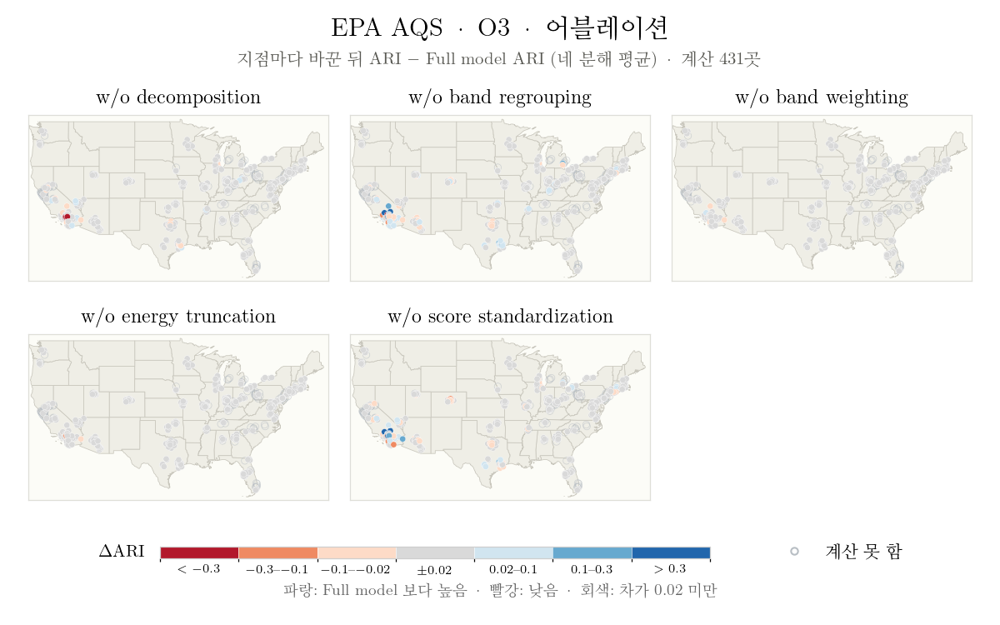

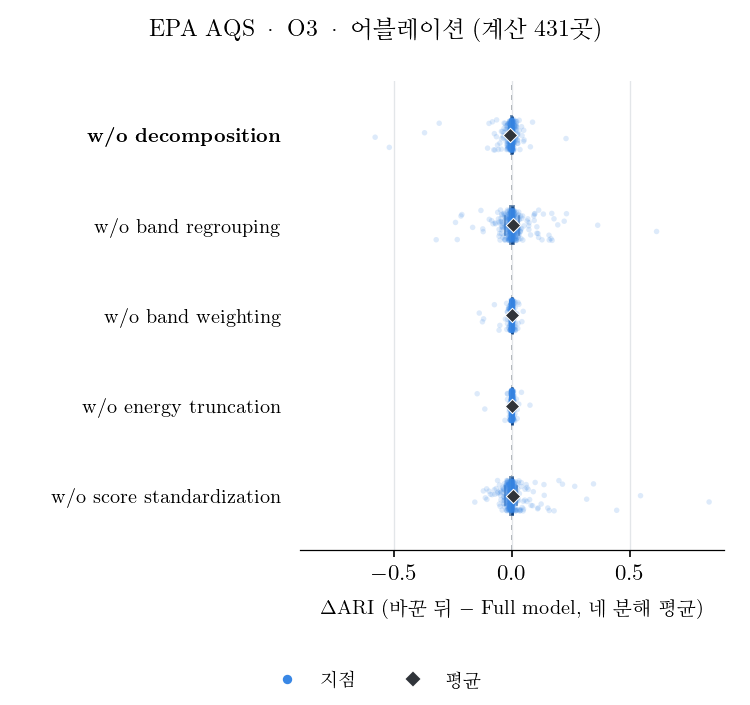
:::


## OpenAQ

| 바꾼 것 | VMD | CEEMDAN | EEMD | EMD |
|---|---:|---:|---:|---:|
| Full model | 0.480 | 0.480 | 0.480 | 0.480 |
| **w/o decomposition** | 0.419 (-0.061) | 0.419 (-0.061) | 0.419 (-0.061) | 0.419 (-0.061) |
| w/o band regrouping | 0.098 (-0.382) | 0.154 (-0.326) | -0.025 (-0.505) | -0.013 (-0.493) |
| w/o band weighting | 0.631 (+0.151) | 0.415 (-0.065) | 0.621 (+0.141) | 0.480 (+0.000) |
| w/o energy truncation | 0.480 (+0.000) | 0.480 (+0.000) | 0.480 (+0.000) | 0.480 (+0.000) |
| w/o score standardization | 0.810 (+0.330) | 0.806 (+0.326) | 0.815 (+0.335) | 0.537 (+0.057) |

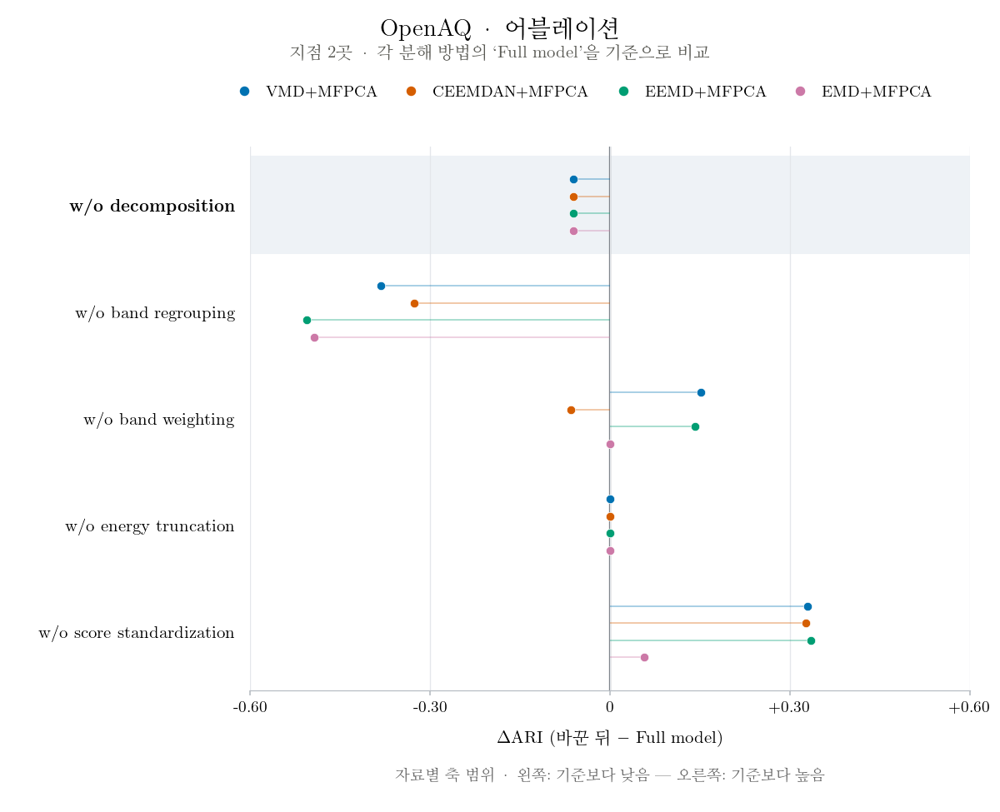

| 지역 | 지점 | w/o decomposition | w/o band regrouping | w/o band weighting | w/o energy truncation | w/o score standardization |
|---|---|---:|---:|---:|---:|---:|
| California / Los Angeles-Long Beach-Anaheim, CA | Los Angeles – N. Main | +0.000 | -0.086 | +0.114 | +0.000 | +0.438 |
| 서울특별시 | 서울 종로구 | -0.122 | -0.767 | +0.000 | +0.000 | +0.086 |


## WEIS

| 바꾼 것 | VMD | CEEMDAN | EEMD | EMD |
|---|---:|---:|---:|---:|
| Full model | 0.039 | 0.030 | 0.042 | 0.032 |
| **w/o decomposition** | 0.064 (+0.026) | 0.064 (+0.034) | 0.064 (+0.022) | 0.064 (+0.032) |
| w/o band regrouping | 0.030 (-0.008) | 0.059 (+0.030) | 0.023 (-0.019) | 0.025 (-0.007) |
| w/o band weighting | 0.025 (-0.013) | 0.026 (-0.004) | 0.042 (+0.000) | 0.032 (+0.000) |
| w/o energy truncation | 0.038 (-0.000) | 0.030 (-0.000) | 0.036 (-0.006) | 0.038 (+0.006) |
| w/o score standardization | 0.033 (-0.006) | 0.032 (+0.002) | 0.032 (-0.010) | 0.038 (+0.006) |

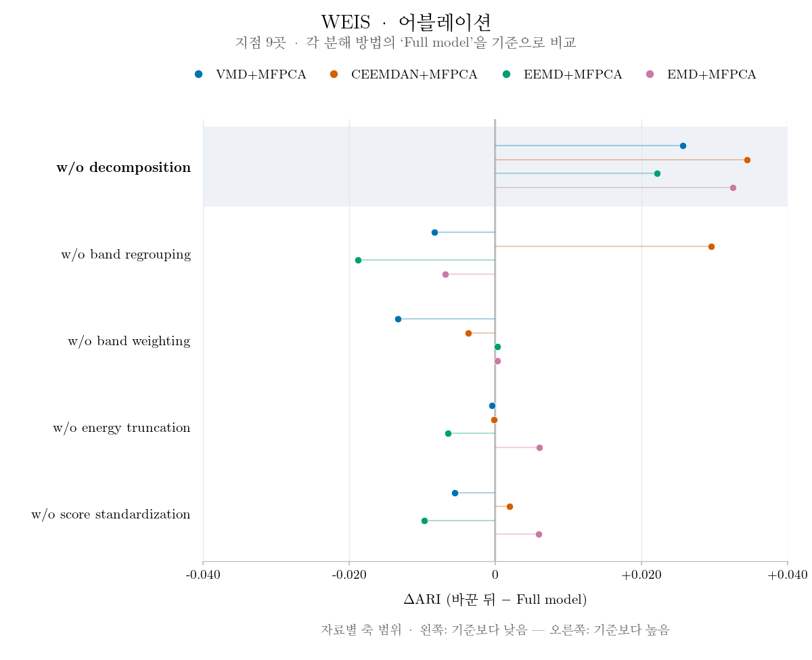

::: {layout="[[62,38]]"}
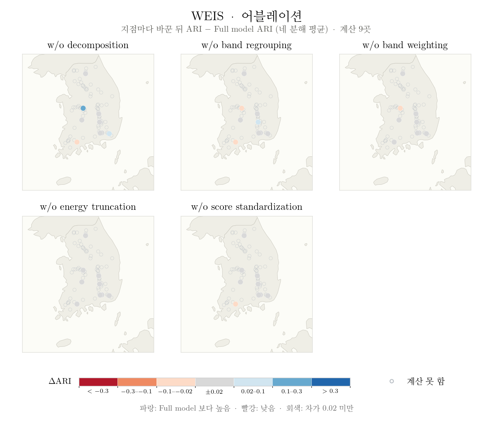

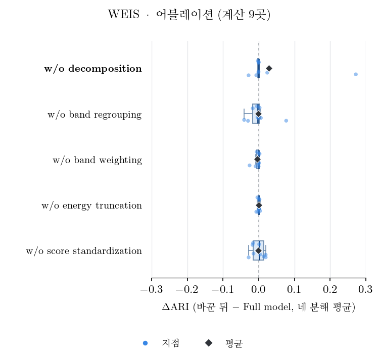
:::

| 지역 | 지점 | w/o decomposition | w/o band regrouping | w/o band weighting | w/o energy truncation | w/o score standardization |
|---|---|---:|---:|---:|---:|---:|
| 강원특별자치도 · 한강 수계 | 의암호 | -0.001 | +0.006 | +0.000 | +0.000 | +0.004 |
| 경상남도 · 낙동강 수계 | 상동 | +0.024 | -0.001 | -0.001 | +0.000 | +0.020 |
| 경상남도 · 낙동강 수계 | 청암 | -0.000 | -0.017 | +0.003 | +0.002 | -0.017 |
| 경상남도 · 낙동강 수계 | 칠서 | -0.001 | -0.003 | +0.000 | +0.002 | -0.015 |
| 경상북도 · 낙동강 수계 | 다산 | -0.007 | +0.077 | -0.009 | -0.007 | +0.020 |
| 경상북도 · 낙동강 수계 | 해평 | -0.002 | -0.005 | -0.005 | -0.004 | -0.016 |
| 전라남도 · 영산·섬진 수계 | 주암호 | -0.028 | -0.030 | -0.000 | -0.001 | -0.028 |
| 전북특별자치도 · 금강 수계 | 용담호 | +0.001 | +0.003 | +0.000 | +0.000 | +0.001 |
| 충청북도 · 금강 수계 | 대청호 | +0.272 | -0.041 | -0.025 | +0.004 | +0.014 |


## USGS

| 바꾼 것 | VMD | CEEMDAN | EEMD | EMD |
|---|---:|---:|---:|---:|
| Full model | 0.082 | 0.074 | 0.089 | 0.076 |
| **w/o decomposition** | 0.095 (+0.012) | 0.095 (+0.021) | 0.095 (+0.005) | 0.095 (+0.018) |
| w/o band regrouping | 0.088 (+0.006) | 0.061 (-0.013) | 0.049 (-0.040) | 0.038 (-0.039) |
| w/o band weighting | 0.073 (-0.009) | 0.071 (-0.003) | 0.088 (-0.002) | 0.077 (+0.001) |
| w/o energy truncation | 0.083 (+0.001) | 0.073 (-0.001) | 0.090 (+0.001) | 0.075 (-0.001) |
| w/o score standardization | 0.068 (-0.014) | 0.066 (-0.007) | 0.073 (-0.016) | 0.064 (-0.012) |


::: {layout="[[62,38]]"}
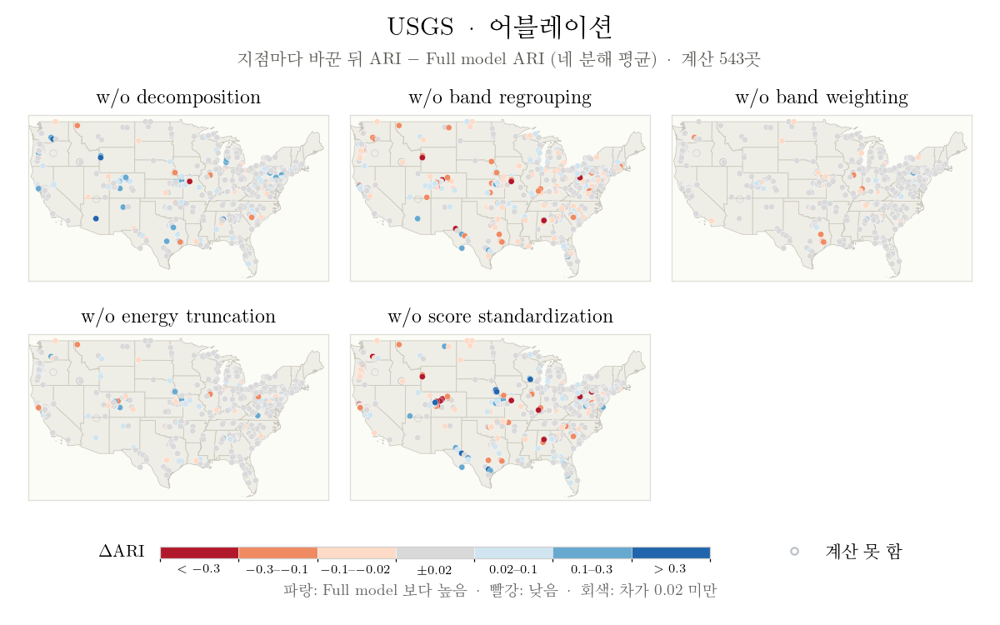

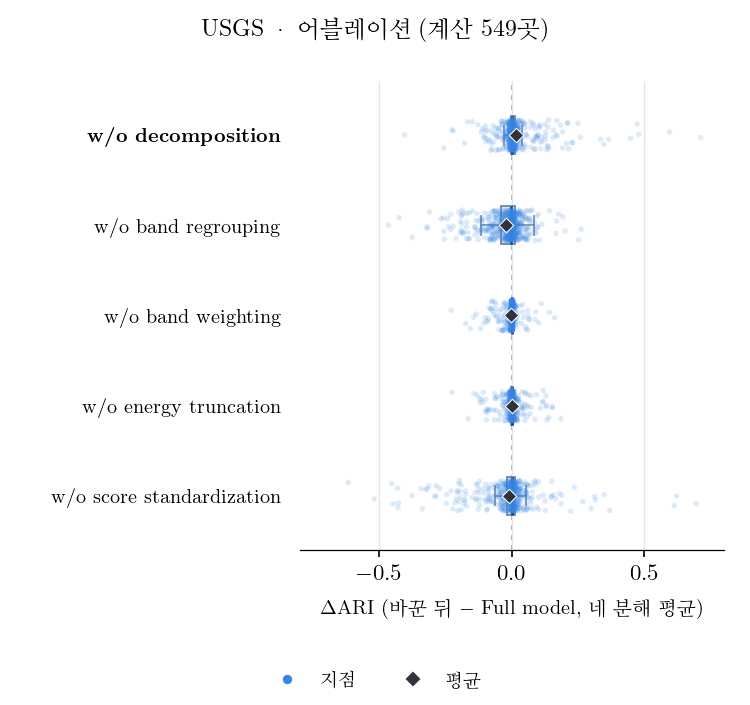
:::


## 기상청 ASOS ①

| 바꾼 것 | VMD | CEEMDAN | EEMD | EMD |
|---|---:|---:|---:|---:|
| Full model | 0.086 | 0.061 | 0.051 | 0.048 |
| **w/o decomposition** | 0.059 (-0.027) | 0.059 (-0.002) | 0.059 (+0.008) | 0.059 (+0.011) |
| w/o band regrouping | 0.038 (-0.048) | -0.003 (-0.064) | -0.013 (-0.064) | -0.010 (-0.058) |
| w/o band weighting | 0.032 (-0.055) | 0.032 (-0.028) | 0.017 (-0.034) | 0.043 (-0.005) |
| w/o energy truncation | 0.086 (-0.001) | 0.060 (-0.000) | 0.065 (+0.015) | 0.051 (+0.003) |
| w/o score standardization | -0.004 (-0.090) | -0.003 (-0.063) | -0.002 (-0.053) | -0.001 (-0.049) |

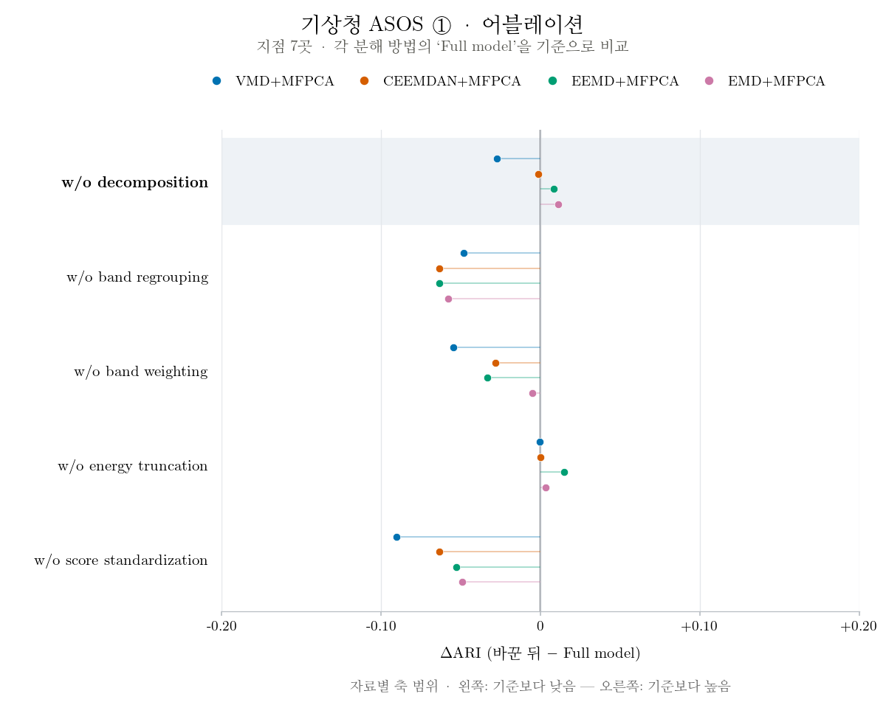

::: {layout="[[62,38]]"}
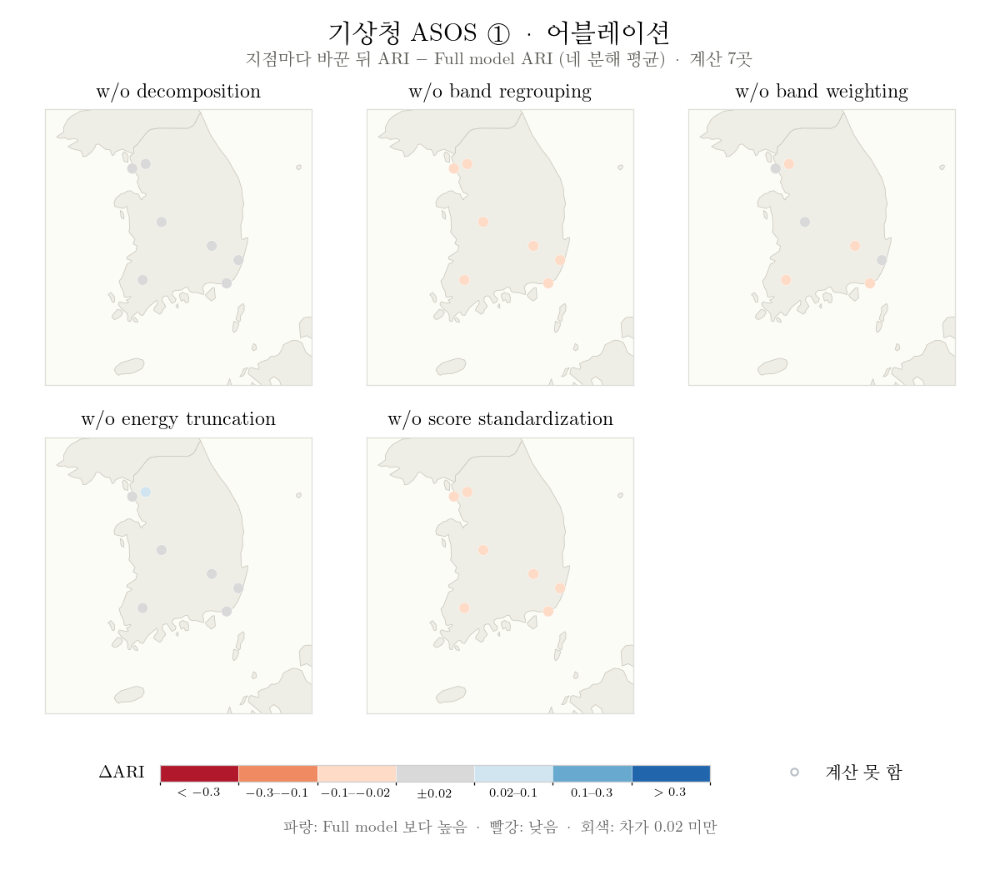

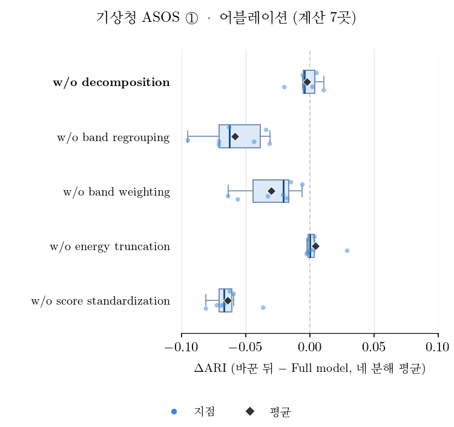
:::

| 지역 | 지점 | w/o decomposition | w/o band regrouping | w/o band weighting | w/o energy truncation | w/o score standardization |
|---|---|---:|---:|---:|---:|---:|
| 대구광역시 | 대구 | -0.004 | -0.095 | -0.021 | +0.003 | -0.067 |
| 대전광역시 | 대전 | -0.005 | -0.034 | -0.006 | -0.001 | -0.059 |
| 부산광역시 | 부산 | +0.011 | -0.071 | -0.056 | -0.003 | -0.081 |
| 서울특별시 | 서울 | +0.002 | -0.071 | -0.064 | +0.029 | -0.072 |
| 울산광역시 | 울산 | -0.004 | -0.031 | -0.018 | -0.002 | -0.036 |
| 인천광역시 | 인천 | +0.005 | -0.063 | -0.015 | +0.004 | -0.062 |
| 전남광주통합특별시 | 광주 | -0.020 | -0.043 | -0.033 | +0.000 | -0.069 |


## 기상청 ASOS ②

| 바꾼 것 | VMD | CEEMDAN | EEMD | EMD |
|---|---:|---:|---:|---:|
| Full model | 0.190 | 0.194 | 0.180 | 0.160 |
| **w/o decomposition** | 0.192 (+0.002) | 0.192 (-0.002) | 0.192 (+0.012) | 0.192 (+0.032) |
| w/o band regrouping | 0.171 (-0.019) | 0.021 (-0.173) | 0.026 (-0.154) | 0.030 (-0.129) |
| w/o band weighting | 0.168 (-0.022) | 0.151 (-0.042) | 0.118 (-0.062) | 0.153 (-0.006) |
| w/o energy truncation | 0.191 (+0.001) | 0.193 (-0.000) | 0.187 (+0.007) | 0.159 (-0.001) |
| w/o score standardization | 0.042 (-0.149) | 0.043 (-0.151) | 0.042 (-0.138) | 0.043 (-0.117) |

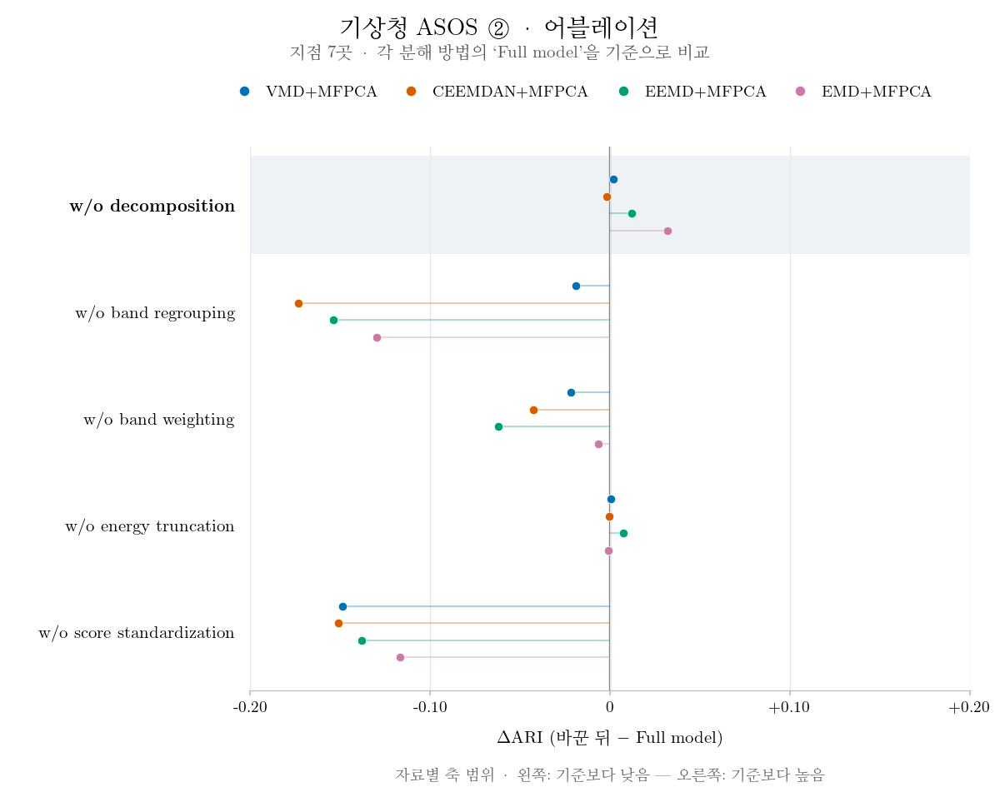

::: {layout="[[62,38]]"}
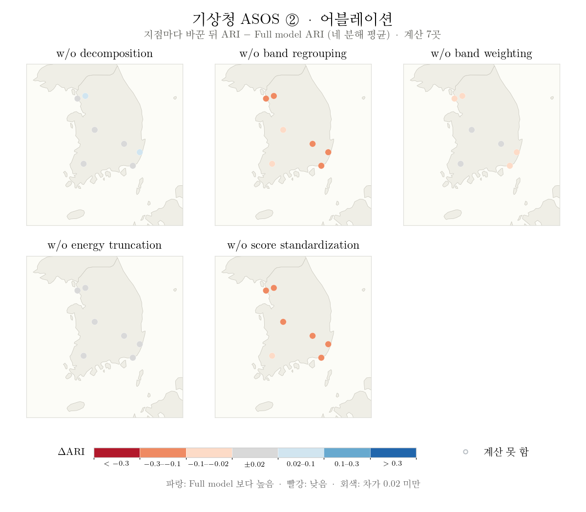

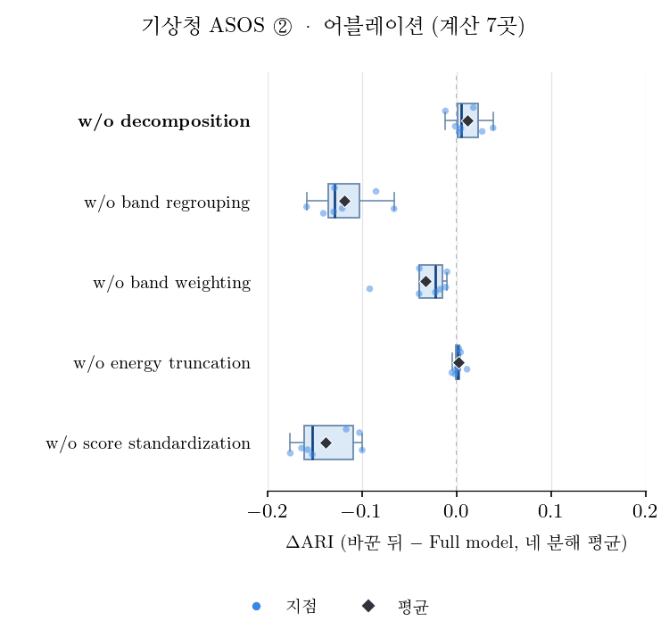
:::

| 지역 | 지점 | w/o decomposition | w/o band regrouping | w/o band weighting | w/o energy truncation | w/o score standardization |
|---|---|---:|---:|---:|---:|---:|
| 대구광역시 | 대구 | -0.001 | -0.159 | -0.012 | +0.001 | -0.164 |
| 대전광역시 | 대전 | -0.012 | -0.085 | -0.010 | +0.004 | -0.103 |
| 부산광역시 | 부산 | +0.003 | -0.141 | -0.040 | -0.002 | -0.153 |
| 서울특별시 | 서울 | +0.039 | -0.121 | -0.092 | +0.011 | -0.158 |
| 울산광역시 | 울산 | +0.027 | -0.130 | -0.022 | -0.005 | -0.176 |
| 인천광역시 | 인천 | +0.018 | -0.129 | -0.039 | +0.003 | -0.117 |
| 전남광주통합특별시 | 광주 | +0.004 | -0.066 | -0.018 | -0.000 | -0.100 |


## NOAA ISD

| 바꾼 것 | VMD | CEEMDAN | EEMD | EMD |
|---|---:|---:|---:|---:|
| Full model | 0.239 | 0.129 | 0.271 | 0.177 |
| **w/o decomposition** | 0.253 (+0.014) | 0.253 (+0.124) | 0.253 (-0.017) | 0.253 (+0.076) |
| w/o band regrouping | 0.230 (-0.010) | 0.219 (+0.090) | 0.211 (-0.059) | 0.110 (-0.067) |
| w/o band weighting | 0.241 (+0.002) | 0.033 (-0.096) | 0.255 (-0.016) | 0.145 (-0.032) |
| w/o energy truncation | 0.240 (+0.001) | 0.129 (-0.000) | 0.267 (-0.004) | 0.125 (-0.052) |
| w/o score standardization | 0.220 (-0.020) | 0.204 (+0.075) | 0.223 (-0.048) | 0.178 (+0.000) |

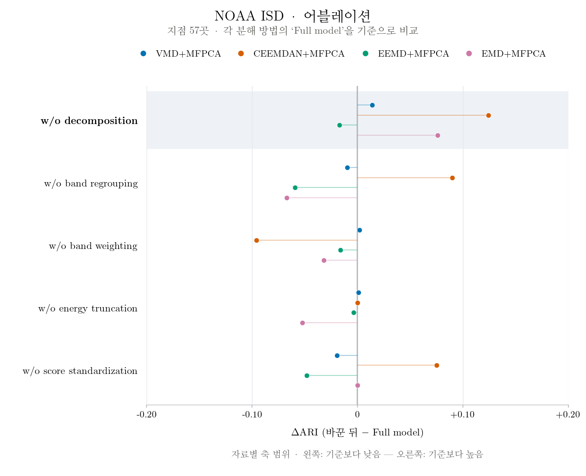

::: {layout="[[62,38]]"}
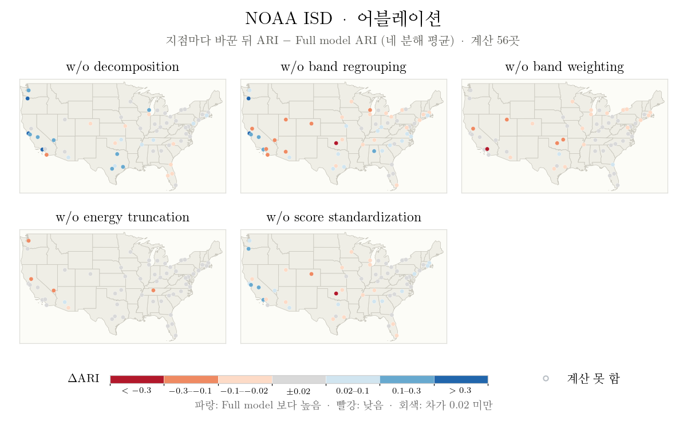

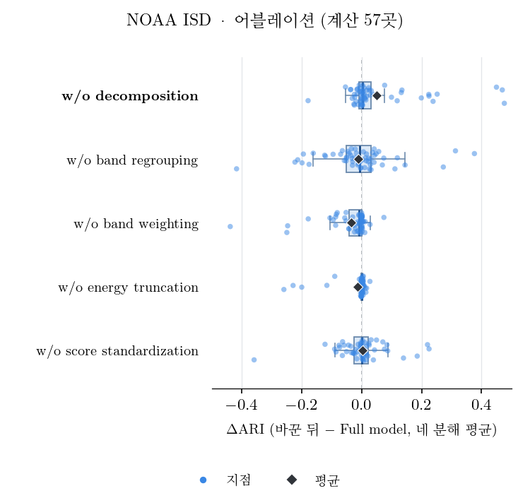
:::


:::

```{ojs}
//| echo: false
//| output: false
decData = FileAttachment("attachments/261015_c90dd3_r2pick/r2pick.json").json()
function decPick(key) {
  const L = decData[key];
  const sel = Inputs.select(L.map((d, i) => i), {label: `지점 (${L.length}곳)`, format: i => L[i].label, width: "100%"});
  const img = html``;
  const cap = html`<figcaption class="figure-caption">${L[0].caption}</figcaption>`;
  sel.addEventListener("input", () => { const d = L[sel.value]; img.src = d.src; cap.textContent = d.caption; });
  return html`<figure class="figure">${sel}${img}${cap}</figure>`;
}
```
